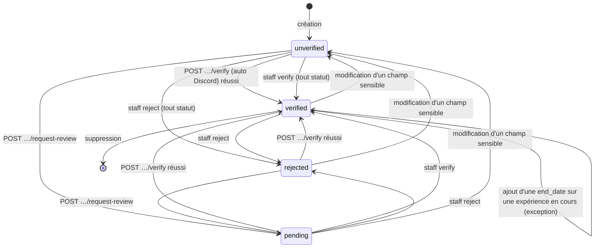
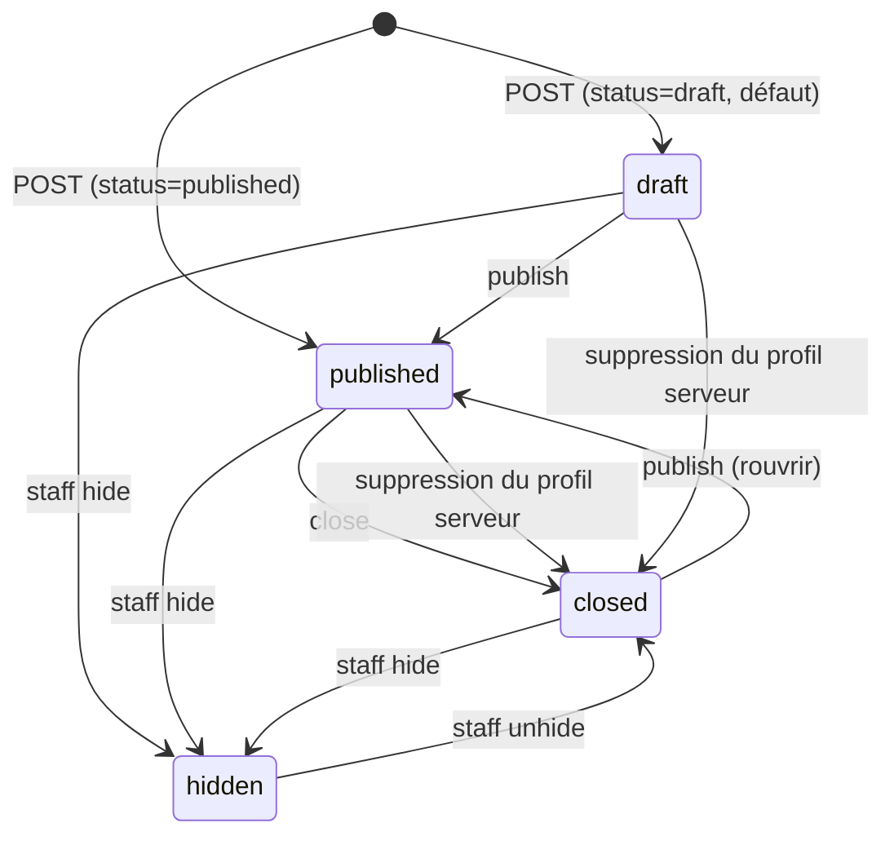

# Lineup — référence complète (backend + guide d'intégration front)

> Doc **destinée au front** de Lineup (`lineup.moddy.app`, un site Vite séparé du
> dashboard). Elle explique tout ce qu'il faut pour construire le site **sans lire le
> code du backend** : concepts, connexion, droits, catalogue, les 41 routes sous
> `/lineup` (requêtes, réponses, erreurs), machines d'états, pièges et pages à écrire.
> Complète `docs/API_ENDPOINTS.md` §Lineup (résumé des routes) et `docs/MODDY_DB.md`
> §26 (tables). **Quand cette doc et le code divergent, le code fait foi** : signalez
> l'écart.

Sommaire : §0 Conventions · §1 Vue d'ensemble · §2 Connexion · §3 Accès à un serveur ·
§4 Catalogue · §5 Objets partagés · §6 Endpoints · §7 Expériences et vérification ·
§8 Annonces · §9 Profils · §10 Badges · §11 Modération · §12 Codes d'erreur ·
§13 Guide d'intégration front · §14 Tables · §15 Redis · §16 Limites connues.

---

## 0. Conventions

| Sujet | Détail |
|---|---|
| **Base URL** | `https://api.moddy.app` (la même API que le dashboard) |
| **Préfixe** | toutes les routes sont sous `/lineup` |
| **Auth** | cookie `session_token` (posé par l'API, domaine `.moddy.app`, `HttpOnly`, `Secure`, `SameSite=Lax`) **ou** `Authorization: Bearer <token>`. Côté navigateur : `fetch(url, { credentials: "include" })` |
| **IDs Discord** | toujours des **chaînes** dans les réponses (un snowflake de 19 chiffres déborde `Number`). En entrée : chaînes pour les corps JSON et les query, entiers décimaux dans les chemins (`/lineup/guilds/123…`) |
| **IDs d'objets Lineup** | UUID (annonces, expériences, signalements), en chaînes |
| **Dates** | ISO 8601 UTC (`2026-10-20T14:03:11.482913+00:00`) ; les dates calendaires (`start_date`, `end_date`) sont `YYYY-MM-DD` |
| **Corps** | JSON (`Content-Type: application/json`). **Les champs inconnus sont refusés** (422) : une faute de frappe n'est jamais ignorée |
| **PATCH / PUT partiels** | seuls les champs **envoyés** changent. Un `null` explicite = « effacer » (là où c'est permis), l'absence = « ne pas toucher » |
| **Suppression** | `DELETE` répond `204` sans corps |

### CORS et `Origin` sur les écritures

Le CORS autorise `https://moddy.app` et tout sous-domaine (`https://lineup.moddy.app`
compris), HTTPS uniquement, **sans port**. Un navigateur envoie `Origin` sur chaque
écriture : si l'origine n'est pas autorisée, l'API répond `403 {"error": "Origin not
allowed"}` avant même de lire la requête. Conséquences :

- le site de production doit être servi depuis `*.moddy.app` en HTTPS ;
- en développement local, `http://localhost:5173` / `:3000` / `127.0.0.1:5173` ne sont
  autorisés que si l'API tourne avec `ENVIRONMENT=dev` ;
- ne jamais appeler l'API depuis un autre domaine : le cookie ne suivrait de toute façon pas.

### Forme des erreurs (exacte)

Le gestionnaire global de `app/main.py` range **toujours** le `detail` d'une
`HTTPException` sous la clé `error`. Trois formes existent ; **le front doit les gérer
toutes**.

**1. Erreur Lineup (la plupart des 4xx métier)** — `error` est un objet, et ses champs
sont **aussi recopiés à la racine** :

```json
{
  "error": { "code": "lineup_quota_exceeded", "message": "Limite de 5 annonces publiées atteinte.", "limit": 5, "scope": "guild" },
  "code": "lineup_quota_exceeded",
  "message": "Limite de 5 annonces publiées atteinte.",
  "limit": 5,
  "scope": "guild"
}
```

Le front branche sur `code` (stable, listé §12), **jamais sur `message`** (français,
affichable en secours mais susceptible d'être reformulé). Les champs de contexte
(`limit`, `scope`, `reason`, `login_url`, `retry_after`, `guild_id`, `field`,
`current_status`, `can_request_review`) sont documentés par erreur. Lire
`body.error.code` ou `body.code` est équivalent.

**2. Erreur de sanction globale** (403) — `error` est un objet **sans** recopie à la
racine : `body.error.code` vaut `user_suspended` ou `guild_suspended`.

```json
{ "error": { "code": "user_suspended", "level": "ban", "subject_type": "discord_user", "subject_id": "1234567890123456789",
             "references": ["A7F2K9"], "expires_at": null,
             "message": "Votre accès à Moddy est suspendu.", "violations_url": "https://moddy.app/violations" } }
```

Un compte suspendu reçoit ça sur **toutes** les routes authentifiées de Lineup (elles
passent par `current_user`) ; il ne peut plus écrire, ni voir `/lineup/me`. Proposer le
lien `violations_url`. Les lectures publiques restent ouvertes pour lui.

**3. Erreur « texte »** — `error` est une chaîne : `401 {"error": "Non authentifie"}` /
`{"error": "Session expiree"}`, `403 {"error": "Staff only"}`, `403 {"error": "Origin not
allowed"}`, `404 {"error": "Not Found"}` (route inconnue).

**4. Validation (422 « standard »)** — corps ou paramètre mal formé, rejeté avant la
logique métier :

```json
{ "error": "Validation error",
  "detail": [ { "type": "string_too_short", "loc": ["body", "title"], "msg": "String should have at least 5 characters",
                "input": "Hey", "ctx": { "min_length": 5 } } ] }
```

`detail[].loc` indique le champ (`["body", "<champ>"]`, `["query", "<param>"]`,
`["path", "<param>"]`), utile pour surligner un champ de formulaire. Les `msg` des
règles métier de Lineup (liens, tags, conditions…) sont en français ; ceux de Pydantic
sont en anglais.

Helper conseillé :

```ts
async function api<T>(path: string, init: RequestInit = {}): Promise<T> {
  const res = await fetch(`https://api.moddy.app${path}`, {
    credentials: "include",
    headers: init.body ? { "Content-Type": "application/json" } : undefined,
    ...init,
  });
  if (res.status === 204) return undefined as T;
  const body = await res.json().catch(() => null);
  if (res.ok) return body as T;
  const e = body?.error;
  throw Object.assign(new Error(typeof e === "string" ? e : e?.message ?? "Erreur"), {
    status: res.status,
    code: typeof e === "object" ? e?.code ?? null : null, // ex. "lineup_quota_exceeded"
    context: typeof e === "object" ? e : null,            // limit, reason, login_url, retry_after…
    validation: Array.isArray(body?.detail) ? body.detail : null, // 422 standard
    retryAfterHeader: res.headers.get("Retry-After"),
  });
}
```

### Pagination

Les listes paginées (`GET /lineup/posts`, `/lineup/me/posts`, `/lineup/guilds`,
`/lineup/staff/experiences`, `/lineup/staff/reports`) rendent
`{ "items": [...], "next_cursor": "<opaque>" | null }` et acceptent `limit` +
`cursor`.

- `cursor` est **opaque** : ne jamais le fabriquer ni l'interpréter, le renvoyer tel quel.
  Un curseur altéré donne `422 cursor_invalid`.
- `next_cursor: null` = fin de la liste.
- **Une page peut être plus courte que `limit`, voire vide, avec un `next_cursor` non nul** :
  les annonces d'un auteur ou d'un serveur suspendu sont retirées *après* la lecture.
  Suivre `next_cursor` tant qu'il existe ; ne jamais conclure « fin » à partir d'une page courte.
- Seule exception : `GET /lineup/staff/badges` pagine par `limit` / `offset` (sans curseur).

### Cache

| Route | `Cache-Control` | Cache serveur |
|---|---|---|
| `GET /lineup/catalog` | `public, max-age=3600` | — (le catalogue ne change qu'à un déploiement) |
| `GET /lineup/posts` | `public, max-age=60` | Redis 60 s, par combinaison de filtres + curseur |
| `GET /lineup/guilds` (annuaire) | `public, max-age=60` | — (base seule) |
| autres routes | rien posé par la route ; l'API ajoute `no-store` dès qu'un cookie de session est présent | — |

Conséquence : une annonce publiée, fermée ou masquée peut rester jusqu'à ~60 s dans le
flux. Après une écriture de l'utilisateur, **ne pas relire le flux pour afficher le
résultat** : mettre à jour l'état local avec la réponse de l'écriture (elle contient
l'objet complet).

### Limites de débit

| Route | Limite | Erreur |
|---|---|---|
| `POST /lineup/reports` | 10 par heure et par personne | `429 lineup_rate_limited` + `retry_after` (secondes) dans le corps |
| `POST /lineup/me/experiences/{id}/verify` | 5 tentatives par 10 min et par personne | `429 lineup_rate_limited` + `retry_after` |
| `POST /lineup/guilds/{id}/refresh` | 1 par minute et par serveur | `429 lineup_rate_limited` + `retry_after` (TTL restant de la clé, 60 s à défaut) |

**Tous** les 429 `lineup_rate_limited` portent le délai à la fois **dans le corps**
(`retry_after`, entier ≥ 1) et dans l'en-tête `Retry-After` (mêmes secondes ; `lineup_error`
le dérive du corps, repli 60 s). Une panne de Redis ne bloque personne (le limiteur échoue ouvert).
Un doublon de signalement (`created: false`) est repéré **avant** le limiteur : il ne consomme
pas le quota.
Les autres routes n'ont pas de limite propre, mais celles qui appellent Discord
(invitations, listes de serveurs) en subissent une en amont : voir `discord_unavailable`.

### `503 discord_unavailable`

Discord n'a pas répondu (panne, limite de débit, bannissement temporaire du bot, jeton de
la personne mort). **Ce n'est jamais un « non »** : l'API refuse de trancher sur une
incertitude. Le corps est une erreur Lineup standard et la réponse porte **toujours**
`Retry-After: 30` : proposer « Réessayer » après ce délai (backoff exponentiel conseillé).
Sur les lectures publiques, Discord muet ne produit **jamais** d'erreur : l'ancien
instantané est servi avec `stale: true`.

---

## 1. Vue d'ensemble

**Lineup** est la nouvelle plateforme Moddy (`lineup.moddy.app`) qui met en relation les
**serveurs Discord qui recrutent du staff** et les **personnes qui cherchent à en
rejoindre un**, un peu comme un LinkedIn de la modération Discord. Le backend FastAPI
existant l'héberge sous `/lineup`, avec le même cookie de session que le dashboard.

### Concepts

| Concept | Ce que c'est |
|---|---|
| **Profil serveur** | La fiche publique d'un serveur sur Lineup : description, liens, thème, tags, langues, invitation permanente, badges, équipe, annonces. Créé en **revendiquant** le serveur (§3). Un instantané Discord (nom, icône, membres…) y est rattaché. |
| **Profil utilisateur** | La fiche publique d'une personne : titre, bio, liens, langues, fuseau, « ouvert aux offres », badges, annonces, expériences. Existe dès que la personne s'est connectée via Lineup ou qu'un tiers la consulte (créé à la volée depuis Discord). |
| **Annonce serveur** (`kind: "guild"`) | « Nous recrutons un modérateur » : publiée par un gestionnaire du serveur. |
| **Annonce utilisateur** (`kind: "user"`) | « Je cherche une équipe » : publiée par une personne, avec éventuellement une **expérience vérifiée mise en avant**. |
| **Expérience** | Une ligne du CV de la personne : un poste tenu sur un **serveur Discord** (avec invitation permanente) ou sur un **service** hors Discord, avec dates. Elle est **non vérifiée** par défaut et peut être vérifiée automatiquement (Discord) ou par le staff Moddy. |
| **Vérification** | `unverified` → `pending` → `verified` / `rejected` (§7). |
| **Badges** | Pastilles sur les profils : calculées (Discord vérifié, Moddy installé, équipe Moddy…) ou attribuées à la main par le staff (§10). |
| **Signalement** | Un utilisateur signale une annonce, un profil ou un serveur ; le staff traite la file (§11). |

### Phase 1 (ce qui existe maintenant)

Connexion dédiée, catalogue, profils serveur / utilisateur, revendication de serveur par
invitation, annonces (brouillon / publiée / fermée / masquée, quotas, expiration
facultative), flux public filtrable, expériences avec vérification automatique et
manuelle, badges, signalements, console staff (vérification, badges, masquage, file de
signalements).

### Feuille de route (pas encore là — ne rien construire dessus)

- **Formulaire Lineup** : un questionnaire de candidature hébergé par Lineup. Le type de
  candidature `lineup_form` est **réservé** : il apparaît dans le catalogue
  (`available: false`) et toute écriture qui le porte répond `422 lineup_form_unavailable`.
- **Candidatures** : aujourd'hui une annonce ne fait que renvoyer vers un lien externe ou
  un MP Discord ; il n'y a pas de candidatures Lineup, donc aucune vérification d'un
  candidat (voir `verified_by_lineup`, §8).
- **Vérification d'âge** : la condition `min_age` est déjà déclarable mais pas vérifiable
  (`verifiable: "future"`).
- **Gestion de staff Moddy** : la méthode de vérification `moddy_staff_system` existe dans
  l'enum mais n'est produite par aucun code pour l'instant.
- **Intégration au bot et au dashboard** : certaines parties de Lineup iront aussi dans le
  dashboard et le bot ; le code backend est isolé dans `app/lineup/` pour ça.

---

## 2. Connexion

Lineup utilise **le même cookie `session_token`** que le dashboard (domaine `.moddy.app`,
partagé entre `moddy.app`, `lineup.moddy.app` et l'API). Il n'y a **pas** de second
compte : une personne connectée au dashboard est déjà connectée à Lineup, et
inversement.

### Le flux dédié

`GET https://api.moddy.app/lineup/auth/login?redirect=<destination>` est une **navigation
du navigateur** (pas un `fetch`) : l'API répond `302` vers l'écran d'autorisation Discord.

- **Scopes demandés** : `identify email guilds guilds.members.read`. (Le dashboard
  demande les trois premiers ; `guilds.members.read` est le seul de plus. Il sert à
  vérifier une expérience — voir §7.)
- **Callback** : le même que le dashboard (`/auth/discord/callback`) — aucune URI de
  redirection de plus à déclarer. L'API crée la session, pose le cookie, puis redirige.
- **Après la connexion** : l'API amorce, côté Lineup, la liste complète des serveurs de la
  personne (cache Redis 5 min, **jamais dans la session**) et son instantané Discord public.
  Si ça échoue, la connexion réussit quand même.

```
lineup.moddy.app ──navigation──► api.moddy.app/lineup/auth/login?redirect=…
        ▲                                   │ 302
        │                                   ▼
        │                       discord.com/oauth2/authorize
        │                                   │ code + state
        │                                   ▼
        │                       api.moddy.app/auth/discord/callback  (pose le cookie)
        └──────────── 302 vers la destination ◄──┘
```

### `?redirect=` (destination après connexion)

Deux formes acceptées :

1. une **URL absolue** en `https` sur `moddy.app` ou un sous-domaine (`https://lineup.moddy.app/posts/…`),
   sans identifiants dans l'URL et sans port autre que 443 ;
2. un **chemin relatif** commençant par `/` (pas `//`), rattaché à `https://lineup.moddy.app`
   (`/me/experiences` → `https://lineup.moddy.app/me/experiences`).

Toute autre valeur (autre domaine, `http`, `javascript:`, caractères de contrôle…) est
**ignorée sans erreur** : la destination devient `https://lineup.moddy.app`. Sans
`redirect`, même défaut. La destination est figée à l'aller dans un jeton `state`
(usage unique, 5 min), jamais relue depuis l'URL de retour.

```ts
const login = (to = location.href) =>
  (location.href = `https://api.moddy.app/lineup/auth/login?redirect=${encodeURIComponent(to)}`);
```

### Refus de l'utilisateur : `?auth_error=`

Si la personne clique « Refuser » sur Discord, elle est ramenée à la destination avec
`?auth_error=<code Discord>` (typiquement `access_denied`, 64 caractères max), les autres
paramètres de la destination étant conservés. Aucune session n'est créée. Le front doit
lire ce paramètre au chargement, afficher « Connexion annulée », puis le retirer de
l'URL (`history.replaceState`). Les autres échecs du callback (`state` expiré après plus
de 5 minutes, code manquant…) répondent une erreur JSON `400` sur l'API elle-même : la
personne verra du JSON ; relancer `/lineup/auth/login` règle le cas.

### Session née du dashboard vs de Lineup : `has_lineup_scopes`

`GET /lineup/me` renvoie `has_lineup_scopes` :

| Valeur | Origine de la session | Ce qui marche |
|---|---|---|
| `true` | connexion via `/lineup/auth/login` | tout, y compris la **vérification automatique** d'une expérience |
| `false` | connexion via le dashboard (`/auth/login`) | **tout le reste** : profils, annonces, revendication, gestion de serveurs, expériences, demande de revue manuelle. Seule la vérification automatique répond `403 lineup_reauth_required` |

Quand `has_lineup_scopes` est `false`, ne pas bloquer l'accès : afficher le site
normalement et n'envoyer vers `login_url` (`/lineup/auth/login`, **relatif à l'API** : le
préfixer par `https://api.moddy.app`) que lorsque la personne clique « Vérifier
automatiquement » (ou sur réception de `403 lineup_reauth_required`). Une reconnexion
Lineup **remplace** le cookie par une session aux bons scopes.

### Quand connecter ? (règles pour le front)

| Situation | Action |
|---|---|
| Visiteur anonyme sur une page publique (flux, annonce, profils, annuaire, catalogue) | **Rien** : ces routes marchent sans cookie |
| Clic sur une action protégée (publier, éditer, signaler, mon profil…) sans session (`401`) | `login(location.href)` |
| `401` en cours de navigation (session expirée) | idem ; conserver l'état du formulaire avant la redirection |
| `403 lineup_reauth_required` | `login(location.href)` avec un message « Autorisez la lecture de vos serveurs » |
| `403 user_suspended` | **pas** de reconnexion : afficher la sanction (`violations_url`) |

Déconnexion : `POST https://api.moddy.app/auth/logout` (route du dashboard, même cookie).
Le site Lineup n'a pas de route de déconnexion propre.

---

## 3. Accès à un serveur

Un serveur peut être géré sur Lineup de deux façons : **avec Moddy** (le bot y est) ou
**sans Moddy**, **revendiqué par invitation**. Le profil serveur n'existe qu'après une
revendication (`POST /lineup/guilds/claim`), dans les deux cas.

### Qui est « gestionnaire » d'un serveur ?

`can_manage_guild`, dans cet ordre :

1. **Le staff Moddy** (`is_staff`) passe toujours.
2. **Moddy est sur le serveur** et le serveur figure dans la liste de la session (même règle que
   le dashboard : la personne y a les droits d'administration). Cette liste est celle de la
   session (connexion ou dernier `POST /auth/refresh`).
3. **Sinon**, la liste complète des serveurs de la personne lue chez Discord avec **son** jeton
   OAuth2 (cache 5 min ; relue sur demande, voir `POST /lineup/me/refresh-guilds`) : il faut
   être **propriétaire**, ou avoir la permission **ADMINISTRATOR** ou **MANAGE_GUILD**.

Si ni la session ni le staff ne tranchent **et** que Discord ne répond pas : `503
discord_unavailable` (on ne répond pas « non » sur une incertitude). Si ça persiste sur
une action de gestion alors que la personne vient de se connecter, c'est souvent un jeton
OAuth2 mort : proposer de se reconnecter (`login`).

**Les droits ne sont jamais figés en base.** Ils sont revérifiés à **chaque écriture**
(création/modification/publication d'une annonce de serveur, mise à jour, rafraîchissement
ou suppression du profil, lecture de `/lineup/me/posts?guild_id=…`). Perdre ses droits sur Discord
retire donc l'accès à la prochaine requête. `claimed_by` (qui a revendiqué) n'est qu'une
trace : il ne donne aucun droit.

Un **serveur suspendu globalement** (sanction `ban`, voir `docs/GLOBAL_SANCTIONS.md`) ne
peut ni être revendiqué, ni publier, ni être géré (`403 guild_suspended`, sauf pour le
staff), et son profil et ses annonces disparaissent des lectures publiques (404).

### Revendiquer un serveur : l'invitation **permanente**

`POST /lineup/guilds/claim { "invite": "<code ou lien>" }` ou `{ "guild_id": "<id>" }` (au moins l'un des deux).
**Avec Moddy sur le serveur** (`has_moddy: true` dans `GET /lineup/me/guilds`), envoyer `guild_id` **seul** : il n'y a
plus de champ d'invitation à afficher, l'API lit le serveur par le bot et crée elle-même l'invitation permanente.
**Sans Moddy**, l'invitation reste obligatoire (`guild_id` seul : `422 invite_required`). Si `invite` et `guild_id`
désignent deux serveurs : `422 invite_guild_mismatch`. L'invitation sert de :

- **preuve** de l'identité du serveur (on la résout chez Discord pour obtenir `guild_id`) ;
- **lien public** (« Rejoindre ») affiché sur le profil ;
- **source du nombre de membres en ligne**.

Elle n'est plus exigée pour un serveur Moddy (voir ci-dessus). Seule une invitation **qui n'expire
jamais** est acceptée (une vanity URL convient) ; sinon `422 invite_expiring`. Une
invitation vers un groupe privé ou un ami est refusée (`invite_invalid`).

Formes d'entrée acceptées : le code nu (`AbC123`), `https://discord.gg/AbC123`,
`https://discord.com/invite/AbC123`, `https://discordapp.com/invite/AbC123` (HTTPS
obligatoire pour les liens). Le code fait 2 à 32 caractères `[A-Za-z0-9-]`.

**À expliquer à la personne** (texte d'aide du formulaire) : « Dans Discord, ouvrez les
paramètres du serveur → *Invitations* (ou clic droit sur un salon → *Inviter des gens* →
*Modifier le lien d'invitation*), réglez **Expire après** sur **N'expire jamais**, laissez
« Nombre maximum d'utilisations » sur **Sans limite**, puis copiez le lien. »
(« Sans limite » n'est pas vérifié par l'API ; seul « N'expire jamais » l'est — mais une
invitation à usages limités finirait par ne plus marcher.)

L'invitation est aussi exigée, avec la même règle, pour une **expérience sur un serveur**
(`kind: "guild"`, §7) et pour changer l'invitation d'un profil (`PUT /lineup/guilds/{id}`,
qui refuse une invitation menant à un autre serveur : `422 invite_guild_mismatch`).

`PUT /lineup/guilds/{id}` avec `"invite": null` demande à Moddy de générer une nouvelle invitation
permanente ; possible seulement si Moddy est sur le serveur (sinon `422 invite_required`). Quand le bot n'a pu créer
d'invitation nulle part, `invite.url` vaut `null` : masquer « Rejoindre ».

Si l'invitation est supprimée plus tard dans Discord, le profil reste mais
`invite.valid` passe à `false` au prochain rafraîchissement de l'instantané : inviter les
gestionnaires à en recréer une et à l'enregistrer via `PUT`.

### Lister « mes serveurs »

`GET /lineup/me/guilds` rend l'union des serveurs Moddy de la session et des serveurs
Discord que la personne gère, avec `has_moddy` (le bot y est), `claimed` (un profil
Lineup existe déjà) et `listed` (le profil existe et est visible dans l'annuaire ; `false` sans profil). C'est l'écran
de départ de « Revendiquer / gérer un serveur » : pour un serveur `claimed: false`, proposer « Ajouter » (sans champ
si `has_moddy`, avec le formulaire d'invitation sinon).

---

## 4. Catalogue

`GET /lineup/catalog` — **public**, cache 1 h. Tout ce qui est un choix fermé vient de là :
**ne jamais coder ces listes en dur dans le front**, charger le catalogue au démarrage.
Chaque entrée a un `id` stable (stocké en base, jamais renommé) et un libellé
`label: { fr, en }`.

### Réponse (valeurs réelles)

```json
{
  "positions": [
    { "id": "moderator", "label": { "fr": "Modérateur", "en": "Moderator" } },
    { "id": "admin", "label": { "fr": "Administrateur", "en": "Administrator" } },
    { "id": "community_manager", "label": { "fr": "Community manager", "en": "Community manager" } },
    { "id": "manager", "label": { "fr": "Responsable", "en": "Manager" } },
    { "id": "communication", "label": { "fr": "Communication", "en": "Communication" } },
    { "id": "developer", "label": { "fr": "Développeur", "en": "Developer" } },
    { "id": "graphic_designer", "label": { "fr": "Graphiste", "en": "Graphic designer" } },
    { "id": "support", "label": { "fr": "Support", "en": "Support" } },
    { "id": "event_animator", "label": { "fr": "Animateur d'événements", "en": "Event host" } },
    { "id": "partnership_manager", "label": { "fr": "Responsable partenariats", "en": "Partnership manager" } },
    { "id": "other", "label": { "fr": "Autre", "en": "Other" } }
  ],
  "requirements": [
    { "id": "min_age", "label": { "fr": "Âge minimum", "en": "Minimum age" }, "value_type": "int", "verifiable": "future", "min": 13, "max": 99 },
    { "id": "account_age_days", "label": { "fr": "Ancienneté du compte Discord (jours)", "en": "Discord account age (days)" }, "value_type": "int", "verifiable": "now", "min": 0, "max": 3650 },
    { "id": "server_activity", "label": { "fr": "Activité sur le serveur", "en": "Activity on the server" }, "value_type": "text", "verifiable": "no", "max_len": 200 },
    { "id": "experience_months", "label": { "fr": "Expérience (mois)", "en": "Experience (months)" }, "value_type": "int", "verifiable": "no", "min": 0, "max": 240 },
    { "id": "verified_experience", "label": { "fr": "Expérience vérifiée sur Lineup", "en": "Verified experience on Lineup" }, "value_type": "none", "verifiable": "now" },
    { "id": "languages", "label": { "fr": "Langues parlées", "en": "Spoken languages" }, "value_type": "languages", "verifiable": "no" },
    { "id": "availability_hours", "label": { "fr": "Disponibilité (heures par semaine)", "en": "Availability (hours per week)" }, "value_type": "int", "verifiable": "no", "min": 1, "max": 168 },
    { "id": "voice_required", "label": { "fr": "Micro / vocal requis", "en": "Voice required" }, "value_type": "bool", "verifiable": "no" },
    { "id": "custom", "label": { "fr": "Condition personnalisée", "en": "Custom requirement" }, "value_type": "text", "verifiable": "no", "max_len": 200, "requires_label": true, "label_max_len": 80 }
  ],
  "application_types": [
    { "id": "external_url", "label": { "fr": "Lien externe", "en": "External link" }, "available": true, "needs_url": true },
    { "id": "discord_dm", "label": { "fr": "Message privé Discord", "en": "Discord DM" }, "available": true, "needs_url": false },
    { "id": "lineup_form", "label": { "fr": "Formulaire Lineup", "en": "Lineup form" }, "available": false, "needs_url": false }
  ],
  "themes": [
    { "id": "gaming", "label": { "fr": "Jeux vidéo", "en": "Gaming" } },
    { "id": "roleplay", "label": { "fr": "Jeu de rôle", "en": "Roleplay" } },
    { "id": "community", "label": { "fr": "Communauté", "en": "Community" } },
    { "id": "education", "label": { "fr": "Éducation", "en": "Education" } },
    { "id": "tech", "label": { "fr": "Technologie", "en": "Tech" } },
    { "id": "art", "label": { "fr": "Art", "en": "Art" } },
    { "id": "music", "label": { "fr": "Musique", "en": "Music" } },
    { "id": "anime", "label": { "fr": "Anime", "en": "Anime" } },
    { "id": "streaming", "label": { "fr": "Streaming", "en": "Streaming" } },
    { "id": "esport", "label": { "fr": "Esport", "en": "Esports" } },
    { "id": "nsfw", "label": { "fr": "NSFW (18+)", "en": "NSFW (18+)" } },
    { "id": "other", "label": { "fr": "Autre", "en": "Other" } }
  ],
  "languages": [
    { "id": "fr", "label": { "fr": "Français", "en": "French" } },
    { "id": "en", "label": { "fr": "Anglais", "en": "English" } },
    { "id": "es", "label": { "fr": "Espagnol", "en": "Spanish" } },
    { "id": "de", "label": { "fr": "Allemand", "en": "German" } },
    { "id": "pt", "label": { "fr": "Portugais", "en": "Portuguese" } },
    { "id": "it", "label": { "fr": "Italien", "en": "Italian" } },
    { "id": "nl", "label": { "fr": "Néerlandais", "en": "Dutch" } },
    { "id": "pl", "label": { "fr": "Polonais", "en": "Polish" } },
    { "id": "ru", "label": { "fr": "Russe", "en": "Russian" } },
    { "id": "tr", "label": { "fr": "Turc", "en": "Turkish" } },
    { "id": "ar", "label": { "fr": "Arabe", "en": "Arabic" } },
    { "id": "ja", "label": { "fr": "Japonais", "en": "Japanese" } },
    { "id": "ko", "label": { "fr": "Coréen", "en": "Korean" } },
    { "id": "zh", "label": { "fr": "Chinois", "en": "Chinese" } }
  ],
  "compensations": [
    { "id": "volunteer", "label": { "fr": "Bénévole", "en": "Volunteer" } },
    { "id": "paid", "label": { "fr": "Rémunéré", "en": "Paid" } },
    { "id": "negotiable", "label": { "fr": "À négocier", "en": "Negotiable" } }
  ],
  "badges": [
    { "id": "discord_verified", "label": { "fr": "Serveur vérifié Discord", "en": "Discord verified" }, "entity": "guild", "source": "computed" },
    { "id": "discord_partner", "label": { "fr": "Partenaire Discord", "en": "Discord partner" }, "entity": "guild", "source": "computed" },
    { "id": "moddy_installed", "label": { "fr": "Moddy installé", "en": "Moddy installed" }, "entity": "guild", "source": "computed" },
    { "id": "moddy_premium", "label": { "fr": "Moddy Premium", "en": "Moddy Premium" }, "entity": "both", "source": "computed" },
    { "id": "nsfw", "label": { "fr": "NSFW (18+)", "en": "NSFW (18+)" }, "entity": "guild", "source": "computed" },
    { "id": "moddy_staff", "label": { "fr": "Équipe Moddy", "en": "Moddy team" }, "entity": "user", "source": "computed" },
    { "id": "discord_staff", "label": { "fr": "Employé Discord", "en": "Discord staff" }, "entity": "user", "source": "discord" },
    { "id": "discord_partnered_server_owner", "label": { "fr": "Propriétaire d'un serveur partenaire", "en": "Partnered server owner" }, "entity": "user", "source": "discord" },
    { "id": "discord_hypesquad_events", "label": { "fr": "HypeSquad Events", "en": "HypeSquad Events" }, "entity": "user", "source": "discord" },
    { "id": "discord_bug_hunter_level_1", "label": { "fr": "Chasseur de bugs (niveau 1)", "en": "Bug hunter (level 1)" }, "entity": "user", "source": "discord" },
    { "id": "discord_bug_hunter_level_2", "label": { "fr": "Chasseur de bugs (niveau 2)", "en": "Bug hunter (level 2)" }, "entity": "user", "source": "discord" },
    { "id": "discord_hypesquad_house_bravery", "label": { "fr": "HypeSquad Bravery", "en": "HypeSquad Bravery" }, "entity": "user", "source": "discord" },
    { "id": "discord_hypesquad_house_brilliance", "label": { "fr": "HypeSquad Brilliance", "en": "HypeSquad Brilliance" }, "entity": "user", "source": "discord" },
    { "id": "discord_hypesquad_house_balance", "label": { "fr": "HypeSquad Balance", "en": "HypeSquad Balance" }, "entity": "user", "source": "discord" },
    { "id": "discord_early_supporter", "label": { "fr": "Soutien de la première heure", "en": "Early supporter" }, "entity": "user", "source": "discord" },
    { "id": "discord_verified_bot", "label": { "fr": "Bot vérifié", "en": "Verified bot" }, "entity": "user", "source": "discord" },
    { "id": "discord_early_verified_bot_developer", "label": { "fr": "Pionnier développeur de bots vérifiés", "en": "Early verified bot developer" }, "entity": "user", "source": "discord" },
    { "id": "discord_certified_moderator", "label": { "fr": "Modérateur certifié Discord", "en": "Discord certified moderator" }, "entity": "user", "source": "discord" },
    { "id": "discord_active_developer", "label": { "fr": "Développeur actif", "en": "Active developer" }, "entity": "user", "source": "discord" },
    { "id": "lineup_verified", "label": { "fr": "Vérifié par Lineup", "en": "Verified by Lineup" }, "entity": "both", "source": "manual" },
    { "id": "moddy_partner", "label": { "fr": "Partenaire Moddy", "en": "Moddy partner" }, "entity": "both", "source": "manual" },
    { "id": "moddy_server", "label": { "fr": "Serveur officiel Moddy", "en": "Official Moddy server" }, "entity": "guild", "source": "manual" }
  ],
  "limits": {
    "max_positions": 5,
    "max_positions_other": 3,
    "position_other_max_len": 40,
    "max_requirements": 15,
    "max_languages": 10,
    "max_tags": 10,
    "tag_pattern": "^[a-z0-9-]{2,24}$",
    "max_links": 5,
    "max_published_posts_per_guild": 5,
    "max_published_posts_per_user": 3,
    "max_experiences": 50,
    "post_max_expiry_days": 180,
    "title": { "min": 5, "max": 100 },
    "description": { "min": 20, "max": 4000 }
  }
}
```

### Lecture des conditions (`requirements`)

| Champ | Sens |
|---|---|
| `value_type` | forme de `value` dans une condition : `int` (entier entre `min` et `max`), `text` (texte non vide ≤ `max_len`), `bool`, `languages` (liste non vide d'ids de langue), `none` (**aucune** valeur : `value` doit être `null`/absent) |
| `verifiable` | `now` : Lineup sait le vérifier dès maintenant (`account_age_days` à partir du snowflake, `verified_experience`) · `future` : prévu (`min_age`, vérification d'âge) · `no` : purement déclaratif |
| `requires_label` / `label_max_len` | `custom` exige un `label` (≤ 80 caractères) : c'est le **titre** de la condition |

Pour construire l'éditeur de conditions : un sélecteur de type (labels du catalogue), puis
un champ adapté à `value_type`, et une case « Vérifié par Lineup » **affichée seulement si
`verifiable !== "no"`**.

### Autres limites (hors `limits`)

| Champ | Limite |
|---|---|
| `title` | 5 à 100 caractères |
| `description` (annonce) | 20 à 4000 |
| `positions` | 1 à 5, ids du catalogue, sans doublon |
| `positions_other` | 0 à 3 libellés de 1 à 40 caractères ; **obligatoire si `other` ∈ `positions`, interdit sinon** |
| `requirements` | ≤ 15 |
| `languages` | ≤ 10 ids du catalogue (dédoublonnés) |
| `tags` | ≤ 10, regex `^[a-z0-9-]{2,24}$` (mis en minuscules et rognés par l'API) |
| `links` (profil) | ≤ 5, `{label: 1–40 car., url}` |
| URL (`links[].url`, `application.url`) | `https` uniquement, ≤ 500 car., sans identifiants, sans espaces, port 443 ou absent |
| `timezone` | zone IANA (`Europe/Paris`) ou décalage `UTC±HH:MM` (`UTC+02:00`, minutes 00–59, heures 00–14), ≤ 64 car. |
| `commitment` | `hours_per_week` 1–168, `compensation` ∈ catalogue, `openings` 1–50 (chaque champ facultatif) |
| profil serveur : `description` | ≤ 2000 |
| profil utilisateur : `headline` ≤ 120, `bio` ≤ 2000 | |
| expérience : `name` 1–100, `description` ≤ 1000, `position_other` 1–40 | |
| `expires_at` d'une annonce | datetime **avec fuseau**, dans le futur, ≤ 180 jours |
| quotas | 5 annonces publiées par serveur, 3 par personne (annonces `user`), 50 expériences |
| signalement | `details` ≤ 1000 ; `reason` ∈ `spam`, `scam`, `inappropriate`, `impersonation`, `other` |

---

## 5. Objets partagés

Formes réutilisées par plusieurs routes (les exemples sont réalistes ; les ids sont
fictifs).

### Badge

```json
{ "id": "moddy_installed", "label": { "fr": "Moddy installé", "en": "Moddy installed" }, "source": "computed" }
```

`source` : `computed` (dérivé à chaque lecture), `manual` (attribué par le staff, seule source
attribuable) ou `discord` (badge public du compte Discord, lu dans `public_flags` de
l'instantané utilisateur ; ids `discord_*`, utilisateur seulement, jamais attribuable ni
retirable à la main). Table de correspondance : `catalog.DISCORD_FLAG_BADGES` (noms de
`routers/auth._DISCORD_FLAGS`, sans `TEAM_PSEUDO_USER` ni `BOT_HTTP_INTERACTIONS`). Le profil
utilisateur les expose, après les badges calculés Moddy, dans l'ordre du catalogue.

**Badges sur les résumés.** Un tableau `badges` (même forme) figure sur `post.guild` et `post.author`,
`team[].user`, `experience.guild`, `GET /lineup/me` (`user.badges`) et les cartes de l'annuaire. Ces badges ne
contiennent ni badges Discord ni `moddy_premium` : de quoi afficher la coche de vérification à côté d'un nom. Les
badges Discord restent sur le profil utilisateur complet.

### Annonce (`Post`)

Forme **publique** (flux, détail, profils). `guild` est `null` pour une annonce `user` ;
`author` vient des instantanés stockés (jamais d'appel Discord, champs à `null` si
inconnus).

```json
{
  "id": "0b6f2c1e-3f0a-4c55-9d2a-6e9d1b0a7c11",
  "kind": "guild",
  "guild_id": "812345678901234567",
  "author_id": "345678901234567890",
  "title": "Cherche 2 modérateurs pour serveur Minecraft FR",
  "description": "Notre communauté de 4 000 membres cherche des modérateurs motivés, disponibles en soirée…",
  "positions": ["moderator", "other"],
  "positions_other": ["Gestionnaire de bots"],
  "requirements": [
    { "type": "min_age", "value": 16, "label": null, "verified_by_lineup": false },
    { "type": "account_age_days", "value": 180, "label": null, "verified_by_lineup": true },
    { "type": "custom", "value": "Savoir utiliser Moddy", "label": "Outils", "verified_by_lineup": false }
  ],
  "application": { "type": "external_url", "url": "https://forms.example.com/modo" },
  "languages": ["fr"],
  "timezone": "Europe/Paris",
  "commitment": { "hours_per_week": 5, "compensation": "volunteer", "openings": 2 },
  "theme": "gaming",
  "tags": ["minecraft", "survie"],
  "featured_experience_id": null,
  "status": "published",
  "expires_at": "2026-12-01T00:00:00+00:00",
  "published_at": "2026-10-20T14:03:11.482913+00:00",
  "created_at": "2026-10-20T13:58:02.100000+00:00",
  "updated_at": "2026-10-20T14:03:11.482913+00:00",
  "is_expired": false,
  "guild": { "id": "812345678901234567", "name": "Cubelands FR", "icon_url": "https://cdn.discordapp.com/icons/812345678901234567/a1b2c3.png", "nsfw": false, "badges": [] },
  "author": { "id": "345678901234567890", "username": "alex", "global_name": "Alex", "avatar_url": "https://cdn.discordapp.com/avatars/345678901234567890/d4e5f6.png", "badges": [] }
}
```

Points de lecture :

- `application` : `null` si non définie ; `{"type": "discord_dm", "url": null}` pour un MP.
- `commitment` : `null` ou `{hours_per_week, compensation, openings}` (chaque champ peut être `null`).
- `expires_at: null` = **n'expire jamais**. `is_expired` est calculé à chaque lecture.
- `published_at` est posé à la **première** publication et jamais remis à `null`
  (une annonce fermée puis rouverte garde sa date d'origine : elle ne « remonte » pas dans le flux).
- `guild.nsfw` : le serveur est NSFW (thème `nsfw` ou niveau Discord 1 ou 3) ; la porte d'âge peut s'appuyer dessus, plus seulement sur le thème de l'annonce.
- `hidden_reason` (motif de masquage) n'est présent **que dans la vue privée** (voir ci-dessous).
- URLs d'images : `https://cdn.discordapp.com/{icons|avatars|banners|splashes}/<id>/<hash>.png` (`.gif` si le hash commence par `a_`) ; `null` si absent. Elles sont déjà construites, ne rien recomposer.

**Vue privée** (`GET /lineup/me/posts`, écritures, détail pour un éditeur) : même objet
**plus** `hidden_reason` (`null` ou texte du staff). Les écritures et le détail ajoutent
aussi `can_edit`.

### Expérience (`Experience`)

```json
{
  "id": "5d0f7a52-8a8b-4f0f-9f4e-1d6a9c2b3e44",
  "kind": "guild",
  "guild_id": "812345678901234567",
  "name": "Cubelands FR",
  "invite_url": "https://discord.gg/cubelands",
  "image_url": "https://cdn.discordapp.com/icons/812345678901234567/a1b2c3.png",
  "member_count": 4120,
  "guild": { "id": "812345678901234567", "name": "Cubelands FR", "icon_url": "https://cdn.discordapp.com/icons/812345678901234567/a1b2c3.png", "badges": [] },
  "position": "moderator",
  "position_other": null,
  "description": "Modération du texte et du vocal, gestion des tickets.",
  "start_date": "2024-03-01",
  "end_date": null,
  "is_current": true,
  "sort_index": 0,
  "verification": {
    "status": "verified",
    "method": "discord_oauth",
    "verified_at": "2026-10-20T14:10:44.000000+00:00"
  }
}
```

- `kind: "service"` : `guild_id`, `invite_url` et `member_count` valent `null`, `name` est saisi à la main.
- `image_url` et `member_count` : pour un serveur, lus dans l'invitation fournie, à la création et quand
  l'invitation change (`image_url` du corps est ignoré). Pour un service, `image_url` est une URL https saisie
  (≤ 500 caractères, modifiable ; `null` l'efface) et `member_count` vaut `null`. Changer l'image ne remet pas la
  vérification à zéro.
- `guild` : `{id, name, icon_url, badges}` quand le serveur a un profil Lineup listé, sinon `null` (aussi pour un
  service). Plus besoin d'un `GET /lineup/guilds/{guild_id}` par expérience (qui renvoyait 404 sans profil).
- `verification.method` : `discord_oauth` | `moddy_staff` | `moddy_staff_system` (réservé) | `null`.
- **Vue publique** (profil d'un tiers) : exactement ci-dessus — **jamais de preuve**.
- **Vue privée** (propriétaire, staff : `GET/POST/PATCH /lineup/me/experiences…`, profil
  consulté par soi-même ou par le staff, `/lineup/staff/*`) ajoute :

```json
{
  "verification": {
    "status": "verified", "method": "discord_oauth", "verified_at": "2026-10-20T14:10:44.000000+00:00",
    "evidence": { "permissions": ["MANAGE_MESSAGES", "MODERATE_MEMBERS"], "owner": false, "role_count": 4, "checked_at": "2026-10-20T14:10:44.000000+00:00" },
    "rejection_reason": null
  },
  "created_at": "2026-10-20T14:09:12.000000+00:00",
  "updated_at": "2026-10-20T14:10:44.000000+00:00"
}
```

  `evidence` peut aussi contenir `review_note` / `requested_at` (demande de revue),
  `staff_note` / `verified_at_by_staff` (validation staff). Les routes staff ajoutent
  `user_id` (propriétaire, chaîne).

### Résumé d'utilisateur (`UserSummary`, équipe d'un serveur)

```json
{ "id": "345678901234567890", "username": "alex", "global_name": "Alex", "display_name": "Alex",
  "avatar_url": "https://cdn.discordapp.com/avatars/345678901234567890/d4e5f6.png",
  "avatar_decoration": { "asset": "a_7f3b…", "sku_id": "1144058844004233369", "url": "https://cdn.discordapp.com/avatar-decoration-presets/a_7f3b….png" },
  "badges": [] }
```

`display_name` = `global_name` sinon `username`. `avatar_decoration` vaut `null` sans décoration. `badges` : voir §5
(sans badges Discord ni `moddy_premium`).

---

## 6. Endpoints

Légende d'auth : **public** (aucune session) · **optionnelle** (marche sans session, enrichit
la réponse avec) · **session** (`current_user` : session valide **et** compte non suspendu)
· **staff** (session + `is_staff`).

Erreurs communes, non répétées ci-dessous : toute route **session** peut répondre `401`
(chaîne), `403 user_suspended` (objet de sanction) et `403 Origin not allowed` (écritures) ;
toute route peut répondre `422` standard (validation) et `5xx`.

### 6.1 Connexion et session

#### `GET /lineup/auth/login`

Auth : public. Query : `redirect` (facultatif, voir §2). Réponse : `302` vers Discord.
Navigation, pas `fetch`. Aucune erreur JSON.

#### `GET /lineup/me`

Auth : session. Résumé de la session. **Jamais de jeton.** Côté front : `user.email` est attendu (facultatif, scope `email` déjà demandé), voir `docs/backend-notes.md` ; il n'est pas encore renvoyé.

```json
{
  "user": {
    "id": "345678901234567890",
    "username": "alex",
    "global_name": "Alex",
    "avatar_url": "https://cdn.discordapp.com/avatars/345678901234567890/d4e5f6.png",
    "banner_url": null,
    "avatar_decoration_data": null,
    "is_staff": false,
    "badges": []
  },
  "has_lineup_scopes": true,
  "login_url": "/lineup/auth/login",
  "profile": {
    "user_id": "345678901234567890",
    "headline": "Modératrice depuis 4 ans",
    "bio": "…",
    "links": [{ "label": "Portfolio", "url": "https://alex.example.com" }],
    "languages": ["fr", "en"],
    "timezone": "Europe/Paris",
    "open_to_work": true,
    "discord_snapshot": { "id": "345678901234567890", "username": "alex", "global_name": "Alex", "avatar": "d4e5f6", "banner": null, "accent_color": null,
                          "avatar_decoration_data": null, "collectibles": null, "display_name_styles": null, "primary_guild": null, "public_flags": 0 },
    "snapshot_at": "2026-10-20T13:50:00.000000+00:00",
    "created_at": "2026-10-20T13:50:00.000000+00:00",
    "updated_at": "2026-10-20T13:50:00.000000+00:00"
  }
}
```

- `profile` vaut `null` tant que la personne n'a ni édité son profil ni eu d'instantané ; c'est
  la ligne brute de la table (utiliser `GET /lineup/me/profile` pour la vue complète du profil).
- `login_url` est **relatif à l'API**.
- Sert aussi de test de session : un `401` ici = pas connecté.

#### `GET /lineup/me/guilds`

Auth : session. Serveurs que la personne peut gérer sur Lineup, triés par nom.

```json
[
  { "id": "812345678901234567", "name": "Cubelands FR", "icon_url": "https://cdn.discordapp.com/icons/812345678901234567/a1b2c3.png", "has_moddy": true, "claimed": true, "listed": true },
  { "id": "923456789012345678", "name": "Atelier d'Alex", "icon_url": null, "has_moddy": false, "claimed": false, "listed": false }
]
```

`listed` : le profil existe et est visible dans l'annuaire (`false` sans profil).

Erreurs : `401`. (Discord muet : la liste ne contient alors que les serveurs Moddy de la
session ; utiliser `refresh-guilds` pour connaître `stale`.)

#### `POST /lineup/me/refresh-guilds`

Auth : session. Corps : aucun. Relit la liste Discord en **sautant le cache** (à appeler
après « j'ai créé/obtenu un serveur » ou avant une revendication qui échoue en 403).

```json
{ "guilds": [ { "id": "812345678901234567", "name": "Cubelands FR", "icon_url": "…", "has_moddy": true, "claimed": true, "listed": true } ], "stale": false }
```

`stale: true` : Discord n'a pas répondu, `guilds` vient de la session (incomplet). Ne met
**pas** à jour la liste de la session des serveurs Moddy (voir §3).

#### `GET /lineup/catalog`

Auth : public. Voir §4.

### 6.2 Serveurs

#### `GET /lineup/guilds` — annuaire public

Auth : public. Aucun appel Discord (base seule). Cache 60 s. Tri : **plus récemment
revendiqués d'abord**. Ne contient que les profils `listed: true`, hors serveurs suspendus
ou blacklistés (retirés *après* lecture : page parfois plus courte).

Query :

| Param | Type | Défaut | Détail |
|---|---|---|---|
| `limit` | int | 24 | 1 à 50 |
| `cursor` | string | — | opaque |
| `include_nsfw` | bool | `false` | `false` exclut thème `nsfw` **et** serveurs dont `nsfw_level` Discord est 1 ou 3 |
| `theme` | string | — | id de thème du catalogue (≤ 30 car.) |
| `q` | string | — | ≤ 100 car. ; recherche (insensible à la casse) dans le nom, la description Lineup et la description Discord |

```json
{
  "items": [
    { "id": "812345678901234567", "name": "Cubelands FR", "icon_url": "https://cdn.discordapp.com/icons/812345678901234567/a1b2c3.png",
      "member_count": 4120, "presence_count": 640, "theme": "gaming", "tags": ["minecraft"],
      "description": "Le plus grand serveur de survie Minecraft francophone.", "nsfw": false,
      "badges": [ { "id": "moddy_installed", "label": { "fr": "Moddy installé", "en": "Moddy installed" }, "source": "computed" } ] }
  ],
  "next_cursor": "WyIyMDI2LTEwLTIwVDEzOjU4OjAyKzAwOjAwIiwgIjgxMjM0NTY3ODkwMTIzNDU2NyJd"
}
```

Les `badges` d'une carte excluent les badges Discord et `moddy_premium` ; le profil complet
les inclut. `description` : description Lineup, sinon description Discord, tronquée à 160 caractères avec « … »
(`null` sans description) ; `nsfw` : booléen (thème `nsfw` ou niveau Discord 1 ou 3). `member_count` / `presence_count` peuvent être `null`.
Erreurs : `422 theme_invalid` · `422 cursor_invalid`.

#### `POST /lineup/guilds/claim` — revendiquer un serveur

Auth : session. Corps : `{ "invite": "https://discord.gg/cubelands" }` (2–200 car.) ou `{ "guild_id": "812345678901234567" }`
(ou les deux ; au moins un). Avec `has_moddy: true`, `guild_id` seul suffit : l'API lit les informations du serveur et
crée l'invitation permanente. Réponse : **`201`** + profil serveur complet (même forme que `GET /lineup/guilds/{id}`,
ci-dessous). Ordre avec une invitation : résolution de l'invitation → droits → doublon.

| Statut | `code` | Quand |
|---|---|---|
| 422 | `invite_invalid` | invitation malformée, hôte non Discord, ou qui ne mène pas à un serveur |
| 404 | `invite_not_found` | invitation inconnue ou expirée |
| 422 | `invite_expiring` | l'invitation a une date d'expiration |
| 422 | `invite_required` | `guild_id` seul, mais Moddy n'est pas sur le serveur : demander une invitation |
| 422 | `invite_guild_mismatch` | `invite` et `guild_id` désignent deux serveurs |
| 403 | `lineup_guild_forbidden` | la personne ne gère pas ce serveur (§3) |
| 403 | `guild_suspended` (objet de sanction) | serveur suspendu globalement |
| 409 | `lineup_guild_already_claimed` | un profil existe déjà ; le corps porte `guild_id` (afficher « Ce serveur est déjà sur Lineup » avec lien vers `/guilds/{guild_id}`) |
| 503 | `discord_unavailable` | Discord muet |

#### `GET /lineup/guilds/{guild_id}` — profil serveur

Auth : optionnelle (la session sert à `can_manage`, et à voir un profil non listé quand on
le gère). Pas de cache serveur.

```json
{
  "id": "812345678901234567",
  "name": "Cubelands FR",
  "icon_url": "https://cdn.discordapp.com/icons/812345678901234567/a1b2c3.png",
  "banner_url": null,
  "splash_url": null,
  "description": "Le plus grand serveur de survie Minecraft francophone.",
  "discord_description": "Survie, mini-jeux et bonne humeur.",
  "invite": { "code": "cubelands", "url": "https://discord.gg/cubelands", "valid": true },
  "links": [ { "label": "Site", "url": "https://cubelands.example.com" } ],
  "theme": "gaming",
  "tags": ["minecraft", "survie"],
  "languages": ["fr"],
  "boosts": 14,
  "boost_tier": null,
  "member_count": 4120,
  "presence_count": 640,
  "created_at": "2021-02-14T09:12:31.231000+00:00",
  "badges": [ { "id": "moddy_installed", "label": { "fr": "Moddy installé", "en": "Moddy installed" }, "source": "computed" },
              { "id": "moddy_premium", "label": { "fr": "Moddy Premium", "en": "Moddy Premium" }, "source": "computed" } ],
  "has_moddy": true,
  "listed": true,
  "posts": [ /* annonces publiées et non expirées du serveur (forme publique §5), 20 max, NSFW inclus */ ],
  "team": [
    { "user": { "id": "345678901234567890", "username": "alex", "global_name": "Alex", "display_name": "Alex",
                "avatar_url": "https://cdn.discordapp.com/avatars/345678901234567890/d4e5f6.png", "avatar_decoration": null, "badges": [] },
      "position": "moderator", "position_other": null, "since": "2024-03-01" }
  ],
  "stale": false,
  "snapshot_at": null,
  "can_manage": false
}
```

- `description` = description Lineup, **avec repli sur la description Discord** ;
  `discord_description` = celle de Discord seule (pour pré-remplir un éditeur).
- `invite.valid: false` : l'invitation du profil n'existe plus chez Discord (masquer le
  bouton « Rejoindre », inviter les gestionnaires à la remplacer). `invite.url` vaut `null` quand le bot n'a pu créer
  d'invitation nulle part : masquer « Rejoindre » aussi.
- `snapshot_at` : date ISO de l'instantané Discord, **pour les gestionnaires seulement** (`null` pour les autres) ; sert
  à « mis à jour il y a… ».
- `created_at` = date de création du **serveur** (déduite du snowflake), pas du profil Lineup.
- `boost_tier` : `premium_tier` Discord (0–3) de l'instantané ; `null` tant que l'instantané date d'avant son ajout (rafraîchi sous 6 h, ou via `POST …/refresh`).
- `has_moddy` : valeur de l'instantané (rafraîchie toutes les 6 h) ; `/lineup/me/guilds`
  donne la valeur à jour.
- `listed` : `false` = profil masqué de l'annuaire ; seuls les gestionnaires (et le staff) le voient.
- `team` : voir §9. `stale: true` : l'instantané date de plus de 6 h **et** n'a pas pu être
  rafraîchi (afficher « Données Discord potentiellement anciennes », rien de bloquant).
- `can_manage` : le visiteur gère ce serveur (afficher les boutons d'édition ; **ne vaut pas
  autorisation** : l'API revérifie à chaque écriture). Une incertitude Discord vaut `false`.
- Le serveur NSFW n'est **pas** bloqué par l'API sur cette route : voir §9.

Erreurs : `404 lineup_guild_not_found` — pas de profil, profil non listé et visiteur non
gestionnaire, ou serveur suspendu/blacklisté (sauf staff). `422` si `guild_id` n'est pas un entier.

#### `PUT /lineup/guilds/{guild_id}` — modifier le profil

Auth : session + gestionnaire du serveur (revérifié). Corps : tous les champs facultatifs,
seuls les champs envoyés changent.

| Champ | Type | Détail |
|---|---|---|
| `description` | string \| null | ≤ 2000 ; `null` efface (retour au texte Discord) |
| `links` | `{label, url}[]` | ≤ 5 ; non nullable (envoyer `[]` pour vider) |
| `theme` | string \| null | id du catalogue ; `null` efface |
| `tags` | string[] | ≤ 10, `^[a-z0-9-]{2,24}$` ; non nullable |
| `languages` | string[] | ≤ 10 ids du catalogue ; non nullable |
| `invite` | string \| null | nouvelle invitation **permanente du même serveur** ; `null` demande à Moddy d'en générer une (seulement si Moddy est sur le serveur, sinon `422 invite_required`) |
| `listed` | bool | non nullable |

Réponse : `200` + profil serveur complet. Erreurs : `403 lineup_guild_forbidden` ·
`403 guild_suspended` · `404 lineup_guild_not_found` (pas de profil) · `404 invite_not_found` ·
`422 invite_invalid` / `invite_expiring` / `invite_guild_mismatch` / `invite_required` · `503 discord_unavailable`.

#### `DELETE /lineup/guilds/{guild_id}`

Auth : session + gestionnaire. Retire le profil et **ferme** ses annonces `draft` et
`published` (elles passent `closed` ; les `hidden` restent masquées). Réponse `204`.
Idempotent (`204` même sans profil). Erreurs : `403 lineup_guild_forbidden` /
`guild_suspended` · `503`. **Demander une confirmation dans l'UI.**

#### `POST /lineup/guilds/{guild_id}/refresh`

Auth : session + gestionnaire. Force la relecture de l'instantané Discord (nom, icône,
membres…). Limite : 1 par minute et par serveur (le contrôle des droits passe **avant** la
limite). Réponse `200` + profil complet (`stale: true` si Discord n'a pas répondu). Erreurs :
`403 lineup_guild_forbidden` · `403 guild_suspended` · `404 lineup_guild_not_found` ·
`429 lineup_rate_limited` (+ `retry_after`, en-tête `Retry-After`) · `503`.

### 6.3 Profils utilisateur

#### `GET /lineup/users/{user_id}` — profil public

Auth : optionnelle (sert à `is_self` et au staff). `user_id` entier dans le chemin.

```json
{
  "id": "345678901234567890",
  "username": "alex",
  "global_name": "Alex",
  "display_name": "Alex",
  "avatar_url": "https://cdn.discordapp.com/avatars/345678901234567890/d4e5f6.png",
  "banner_url": null,
  "accent_color": 5793266,
  "avatar_decoration": { "asset": "a_7f3b…", "sku_id": "1144058844004233369", "url": "https://cdn.discordapp.com/avatar-decoration-presets/a_7f3b….png" },
  "nameplate": { "asset": "nameplates/sakura/", "palette": "crimson", "label": "COLLECTIBLES_NAMEPLATES_SAKURA_A11Y", "sku_id": "1349…", "url": "https://cdn.discordapp.com/assets/collectibles/nameplates/sakura/static.png" },
  "display_name_styles": null,
  "primary_guild": null,
  "headline": "Modératrice depuis 4 ans",
  "bio": "Passionnée de communautés…",
  "links": [ { "label": "Portfolio", "url": "https://alex.example.com" } ],
  "languages": ["fr", "en"],
  "timezone": "Europe/Paris",
  "open_to_work": true,
  "created_at": "2018-05-02T10:11:12.345000+00:00",
  "badges": [ { "id": "moddy_staff", "label": { "fr": "Équipe Moddy", "en": "Moddy team" }, "source": "computed" } ],
  "posts": [ /* annonces `user` publiées et non expirées de la personne, 20 max, forme publique */ ],
  "experiences": [ /* TOUTES ses expériences, dans son ordre (§5) ; vue privée pour soi et le staff */ ],
  "is_self": false,
  "stale": false
}
```

- Les visuels viennent de l'instantané Discord (relu via le bot s'il date de plus de
  24 h). `display_name_styles` et `primary_guild` sont renvoyés **tels que Discord les
  fournit** (objets libres, ou `null`) — à afficher si vous savez les rendre, à ignorer sinon.
- `created_at` = création du **compte Discord** (snowflake).
- `experiences` dépend du visiteur : soi-même et le staff reçoivent **tous les statuts**
  (vue privée) ; un tiers ne reçoit **ni les `rejected`**, et les `pending` y sont présentées
  `unverified` (la revue est privée).
- `badges` inclut les badges publics Discord (`source: "discord"`, §5) dérivés de `public_flags`.
- Le profil n'a pas besoin d'avoir été « créé » : si Discord connaît la personne, la page
  existe (champs Lineup vides).

Erreurs : `404 lineup_user_not_found` — ni profil Lineup ni compte Discord connu, ou compte
suspendu globalement (sauf pour la personne elle-même et le staff).

#### `GET /lineup/me/profile`

Auth : session. Même objet que ci-dessus avec `is_self: true`, vue privée des expériences.

#### `PUT /lineup/me/profile`

Auth : session. Mise à jour partielle ; réponse : le profil complet (comme ci-dessus).

| Champ | Type | Détail |
|---|---|---|
| `headline` | string \| null | ≤ 120 |
| `bio` | string \| null | ≤ 2000 |
| `links` | `{label, url}[]` | ≤ 5 ; non nullable |
| `languages` | string[] | ≤ 10 ids du catalogue ; non nullable |
| `timezone` | string \| null | IANA ou `UTC±HH:MM` |
| `open_to_work` | bool | non nullable |

Erreurs : seulement `422` standard (un `null` sur un champ non nullable est un 422).

### 6.4 Annonces

#### `GET /lineup/posts` — flux public

Auth : public. Annonces `published`, **non expirées**, de la plus récemment publiée à la
plus ancienne. Cache : Redis 60 s + `Cache-Control: public, max-age=60`. Un auteur ou
serveur suspendu est retiré (page parfois plus courte) ; les annonces d'un serveur non
listé (ou sans profil) sont exclues en SQL.

Query :

| Param | Type | Défaut | Détail |
|---|---|---|---|
| `kind` | `guild` \| `user` | — | |
| `positions` | string[] | — | répétable (`?positions=moderator&positions=admin`) **ou** séparé par des virgules ; ≤ 10 ; ids du catalogue ; l'annonce doit en avoir **au moins un** (OU) |
| `languages` | string[] | — | idem (OU) ; non validé : un id inconnu ne donne simplement rien |
| `tags` | string[] | — | idem (OU) |
| `theme` | string | — | égalité exacte |
| `compensation` | string | — | `volunteer` \| `paid` \| `negotiable` |
| `q` | string | — | ≤ 100 car. ; recherche insensible à la casse dans titre et description |
| `guild_id` | string | — | chiffres, 1–19 |
| `author_id` | string | — | chiffres, 1–19 |
| `include_nsfw` | bool | `false` | `false` retire les annonces de thème `nsfw` et celles d'un serveur NSFW |
| `limit` | int | 20 | 1 à 50 |
| `cursor` | string | — | opaque |

```json
{ "items": [ { /* Post publique avec guild + author (§5) */ } ], "next_cursor": null }
```

Erreurs : `422 lineup_filter_invalid` (+ `field`: `kind`, `compensation`, `positions`) ·
`422 cursor_invalid` · `422` standard (`guild_id`/`author_id` non numériques, `limit` hors bornes).

#### `GET /lineup/me/posts` — mes annonces

Auth : session. **Tous les statuts** (brouillons, fermées, masquées, expirées), du plus
récemment **créé** au plus ancien, vue **privée** (avec `hidden_reason`).

| Param | Détail |
|---|---|
| `guild_id` | sans lui : mes annonces (auteur = moi, `guild` et `user`). Avec lui : **toutes les annonces de ce serveur**, quel qu'en soit l'auteur — gestionnaire exigé |
| `status` | `draft` \| `published` \| `closed` \| `hidden` |
| `limit` (1–50, déf. 20), `cursor` | |

Réponse : `{ items, next_cursor }`. Erreurs : `403 lineup_guild_forbidden` ·
`422 lineup_filter_invalid` (`field: "status"`) · `422 cursor_invalid` · `503 discord_unavailable`.

#### `GET /lineup/posts/{post_id}` — détail

Auth : optionnelle. `post_id` : UUID.

Visibilité : une annonce `published` est lisible par tous, **même expirée** (lien direct :
`is_expired: true`) tant que son auteur et son serveur ne sont pas suspendus. Les
annonces `draft`, `closed`, `hidden` ne sont visibles que de leurs **éditeurs** et du staff.
Il en va de même d'une annonce de **serveur non listé** (`listed: false`) ou sans profil Lineup :
comme son profil, elle est cachée au public (404).

Réponse : Post (§5) avec `guild` et `author`, plus `can_edit` ; **`hidden_reason` n'est
présent que si `can_edit` est `true`**.

Erreur : `404 lineup_post_not_found` — id inconnu ou mal formé, **ou** annonce que
l'appelant n'a pas le droit de voir (indistinguable volontairement).

#### `POST /lineup/posts` — créer

Auth : session. Réponse : **`201`** + Post privé + `guild`/`author` + `can_edit: true`.

| Champ | Type | Défaut | Contraintes |
|---|---|---|---|
| `kind` | `"guild"` \| `"user"` | **requis** | |
| `guild_id` | string | — | **requis si `kind=guild`**, interdit si `user` |
| `title` | string | **requis** | 5–100 |
| `description` | string | **requis** | 20–4000 |
| `positions` | string[] | **requis** | 1–5, ids du catalogue, sans doublon |
| `positions_other` | string[] | `[]` | ≤ 3 × 40 car. ; **obligatoire** ssi `other` ∈ `positions` |
| `requirements` | Requirement[] | `[]` | ≤ 15 (ci-dessous) |
| `application` | Application \| null | `null` | ci-dessous |
| `languages` | string[] | `[]` | ≤ 10 |
| `timezone` | string \| null | `null` | IANA ou `UTC±HH:MM` |
| `commitment` | `{hours_per_week?, compensation?, openings?}` \| null | `null` | |
| `theme` | string \| null | `null` | catalogue |
| `tags` | string[] | `[]` | ≤ 10 |
| `featured_experience_id` | uuid \| null | `null` | **annonces `user` seulement** ; expérience **vérifiée** de l'auteur |
| `status` | `"draft"` \| `"published"` | `"draft"` | `published` = publiée tout de suite |
| `expires_at` | datetime \| null | `null` (jamais) | avec fuseau, futur, ≤ 180 j |

`Requirement` : `{ "type": "<id du catalogue>", "value": <selon value_type>, "label": "<texte>"?, "verified_by_lineup": false }`.
Exemples : `{"type":"min_age","value":16}`, `{"type":"verified_experience","verified_by_lineup":true}`
(pas de `value`), `{"type":"languages","value":["fr","en"]}`, `{"type":"voice_required","value":true}`,
`{"type":"custom","value":"Savoir utiliser Moddy","label":"Outils"}`.
`verified_by_lineup: true` n'est accepté que si `verifiable` ≠ `"no"` ; sinon 422.

`Application` : `{ "type": "external_url", "url": "https://…" }` (https, obligatoire), `{ "type": "discord_dm" }`
(**sans** `url`), ou `lineup_form` (réservé → `422 lineup_form_unavailable`).

Erreurs métier :

| Statut | `code` | Quand |
|---|---|---|
| 422 | `lineup_form_unavailable` | `application.type = "lineup_form"` |
| 403 | `lineup_guild_forbidden` | `kind=guild` sans droit de gestion |
| 403 | `guild_suspended` (objet) | serveur suspendu |
| 422 | `lineup_guild_profile_missing` | le serveur n'a pas de profil Lineup (le revendiquer d'abord) |
| 404 | `lineup_experience_not_found` | `featured_experience_id` inconnue ou à quelqu'un d'autre |
| 422 | `lineup_experience_not_verified` | l'expérience mise en avant n'est pas `verified` |
| 422 | `lineup_post_expired` | `status: "published"` avec un `expires_at` déjà passé |
| 409 | `lineup_quota_exceeded` | publication au-delà du quota ; porte `limit` (5 ou 3) et `scope` (`guild` / `user`) |
| 503 | `discord_unavailable` | Discord muet pendant la vérification des droits |

Les règles de forme (longueurs, catalogue, `positions_other` manquant, `guild_id` mal
placé, `featured_experience_id` sur une annonce de serveur, expiration hors bornes…) sont des
**422 standard** (`detail[].loc`).

Un **brouillon** ne compte pas dans le quota et ne vérifie ni l'expiration ni la
publiabilité : les contrôles de publication rejouent à `publish`.

#### `PATCH /lineup/posts/{post_id}` — modifier

Auth : session, **éditeur** de l'annonce (§8). Mêmes champs que la création **sauf** `kind`,
`guild_id`, `status` (refusés : 422). Tous facultatifs. `null` explicite autorisé pour
`application`, `timezone`, `commitment`, `theme`, `featured_experience_id`, `expires_at`
(les effacer) ; interdit pour `title`, `description`, `positions`, `positions_other`,
`requirements`, `languages`, `tags` (422). Un corps vide `{}` renvoie l'annonce inchangée.

Réponse : Post privé. Règles supplémentaires :

- `other` / `positions_other` sont revérifiés sur l'**état fusionné** : `422
  lineup_positions_other_required` / `lineup_positions_other_unexpected`. Retirer `other`
  de `positions` sans toucher `positions_other` vide celui-ci automatiquement.
- `featured_experience_id` sur une annonce de serveur : `422 lineup_featured_experience_user_only` ;
  expérience inconnue : `404 lineup_experience_not_found` ; non vérifiée : `422 lineup_experience_not_verified`.
- `expires_at` passé sur une annonce **publiée** : `422 lineup_post_expired`.
- Une annonce `hidden` ne se modifie plus (hors staff) : `409 lineup_post_hidden`.
- Une annonce `published` reste publiée après modification (pas de re-validation staff).

Erreurs d'accès : `404 lineup_post_not_found` (invisible pour l'appelant) · `403
lineup_post_forbidden` (visible mais non éditable) · `403 guild_suspended` ·
`503 discord_unavailable`.

#### `POST /lineup/posts/{post_id}/publish`

Auth : session, éditeur. Corps : aucun. `draft` ou `closed` → `published` (rouvrir une
annonce fermée = la republier). **Quota, expiration, formulaire, profil serveur et expérience
mise en avant sont revérifiés.** Réponse : Post privé.

Erreurs : `409 lineup_post_invalid_status` (+ `current_status`) — déjà publiée ou masquée ·
`409 lineup_post_hidden` · `422 lineup_post_expired` (modifier `expires_at` d'abord) ·
`422 lineup_form_unavailable` · `422 lineup_guild_profile_missing` ·
`422 lineup_experience_not_verified` · `409 lineup_quota_exceeded` · + erreurs d'accès du PATCH.

#### `POST /lineup/posts/{post_id}/close`

Auth : session, éditeur. `published` → `closed`. Réponse : Post privé. Erreurs :
`409 lineup_post_invalid_status` (+ `current_status`) · `409 lineup_post_hidden` · accès du PATCH.

#### `DELETE /lineup/posts/{post_id}`

Auth : session, éditeur. Suppression **définitive** (`204`). Une annonce `hidden` ne peut
pas être supprimée par un non-staff (`409 lineup_post_hidden` : c'est la pièce des
signalements). Erreurs d'accès du PATCH.

### 6.5 Signalements

#### `POST /lineup/reports`

Auth : session. Corps :

```json
{ "target_type": "post", "target_id": "0b6f2c1e-3f0a-4c55-9d2a-6e9d1b0a7c11", "reason": "scam", "details": "Demande de l'argent avant l'entretien." }
```

`target_type` ∈ `post` (`target_id` = **uuid**), `user` (snowflake), `guild` (snowflake) ;
`reason` ∈ `spam` / `scam` / `inappropriate` / `impersonation` / `other` ; `details` ≤ 1000
(facultatif).

Réponse : **`201`** `{ "id": "…", "status": "open", "created": true }`, ou **`200`**
`{ …, "created": false }` si **cette personne** a déjà un signalement **ouvert** sur la même cible
(afficher « Déjà signalé, merci » : ce n'est pas une erreur). Un seul signalement ouvert par
(signaleur, cible) ; une fois traité par le staff, on peut re-signaler.

Erreurs : `404 lineup_report_target_not_found` (annonce / profil / serveur / utilisateur
inconnu) · `422 lineup_report_self` (on ne signale pas son propre contenu ; pour un serveur,
« propriétaire » = la personne qui l'a revendiqué) · `429 lineup_rate_limited` (+ `retry_after`).
Un doublon est détecté avant le limiteur : il ne consomme pas le quota.

### 6.6 Expériences

Toutes les routes sont **session** et ne voient que **les expériences de l'appelant** (celle
d'un autre → `404 lineup_experience_not_found`). Elles rendent la **vue privée** (§5). Détail
de la machine d'états : §7.

#### `GET /lineup/me/experiences`

`{ "items": [Experience…] }`, dans l'ordre choisi par la personne (`sort_index`, puis
`start_date` décroissante).

#### `POST /lineup/me/experiences`

Réponse : **`201`** + l'expérience (`verification.status: "unverified"`, ajoutée **en dernière
position**).

| Champ | Type | Contraintes |
|---|---|---|
| `kind` | `"guild"` \| `"service"` | **requis** |
| `invite` | string | **requis** si `guild` (invitation permanente) ; interdit si `service` |
| `name` | string | **requis** si `service` (1–100) ; **ignoré** si `guild` (repris de l'invitation) |
| `image_url` | string \| null | service seulement : URL https ≤ 500 car. ; `null` ou absent = pas d'image ; **ignoré** si `guild` (l'icône vient de l'invitation) |
| `position` | string | **requis**, id du catalogue |
| `position_other` | string | obligatoire ssi `position = "other"` (1–40) |
| `description` | string \| null | ≤ 1000 |
| `start_date` | `YYYY-MM-DD` | **requis**, pas dans le futur |
| `end_date` | `YYYY-MM-DD` \| null | `null` = en cours ; pas dans le futur, ≥ `start_date` |

Erreurs : `409 lineup_experience_limit` (50 max) · `404 invite_not_found` · `422 invite_invalid` ·
`422 invite_expiring` · `503 discord_unavailable` · 422 standard.

#### `PATCH /lineup/me/experiences/{exp_id}`

Champs modifiables : `invite` (serveur seulement), `name` (service seulement ; ignoré pour un
serveur), `image_url` (service seulement, `null` l'efface ; ignoré pour un serveur ; ne remet pas la
vérification à zéro), `position`, `position_other`, `description`, `start_date`, `end_date`. **`kind` est
immuable** (le champ est refusé : 422). `position` et `start_date` ne sont pas nullables ;
`end_date: null` = « en cours ». Passer à un poste du catalogue vide `position_other`.

Réponse : l'expérience. **Remise à `unverified`** si un champ qui fonde la vérification change
réellement (serveur/invitation, nom d'un service, poste, `position_other`, dates) alors que le
statut est `verified`, `pending` ou `rejected` ; modifier la description ne change jamais le
statut ; **exception** : poser une `end_date` sur une expérience **vérifiée et en cours**
(la personne a quitté l'équipe) garde `verified` (§7).

Erreurs : `404 lineup_experience_not_found` · `422 lineup_experience_invalid` (état fusionné
invalide : `invite` sur un service, `position_other` manquant/superflu, date future, fin avant
début) · `404 invite_not_found` · `422 invite_invalid` / `invite_expiring` · `503`.

#### `PUT /lineup/me/experiences/order`

Corps : `{ "ids": ["uuid", …] }` — la liste **exacte** de toutes ses expériences, une fois
chacune, dans le nouvel ordre. Réponse : `{ "items": [...] }` dans l'ordre. Erreur :
`422 lineup_experience_order_invalid` (id manquant, en trop, ou en double — recharger la
liste puis réessayer).

#### `DELETE /lineup/me/experiences/{exp_id}`

`204`. Supprime aussi la mise en avant : une annonce qui la référençait garde
`featured_experience_id: null`. Erreur : `404 lineup_experience_not_found`.

#### `POST /lineup/me/experiences/{exp_id}/verify` — vérification automatique

Corps : aucun. Seulement pour une expérience de **serveur** et **en cours**, avec une session
aux scopes Lineup. Algorithme et preuve : §7. Réponse : l'expérience vérifiée (ou telle quelle si
elle l'était déjà).

Ordre des contrôles et erreurs :

| Statut | `code` | Quand |
|---|---|---|
| 404 | `lineup_experience_not_found` | inconnue / pas à vous |
| 422 | `lineup_verification_not_applicable` + `reason` | `reason: "not_guild"` (service) ou `"ended"` (`end_date` posée) — proposer la **revue manuelle** |
| 403 | `lineup_reauth_required` + `login_url` | session sans `guilds.members.read` → renvoyer vers la connexion Lineup |
| 429 | `lineup_rate_limited` + `retry_after` | 5 tentatives / 10 min |
| 422 | `lineup_verification_failed` + `reason` + `can_request_review: true` | `reason: "not_member"` (pas membre du serveur) ou `"no_staff_permission"` (membre sans aucune permission de staff) |
| 503 | `discord_unavailable` | Discord muet : **réessayer**, ne pas conclure à un échec |

Un `lineup_verification_failed` n'est pas définitif : afficher le motif et proposer « Demander
une vérification manuelle » (`request-review`).

#### `POST /lineup/me/experiences/{exp_id}/request-review`

Corps facultatif : `{ "note": "…" }` (≤ 500 ; absent ou `{}` accepté). `unverified` ou
`rejected` → `pending`, pour une revue du staff Moddy (expériences passées, services, échec
de l'auto-vérification). La note est conservée dans la preuve, visible du staff **et du
propriétaire**. Réponse : l'expérience.

Erreurs : `409 lineup_experience_already_verified` · `409 lineup_review_already_pending` ·
`404 lineup_experience_not_found`.

### 6.7 Staff

Toutes sous `/lineup/staff/*`, auth **staff** (`403 {"error": "Staff only"}` sinon). Ids de
chemin : UUID pour expériences / annonces / signalements, **entiers** pour `entity_id`.
Un UUID mal formé est un 422 standard.

#### `GET /lineup/staff/experiences`

Query : `status` ∈ `pending` (défaut) | `unverified` | `verified` | `rejected` ; `limit` (1–100,
déf. 50) ; `cursor`. Triées de la **plus ancienne** modification à la plus récente (la file de
revue se traite dans l'ordre d'arrivée). Réponse : `{ "items": [Experience privée + user_id], "next_cursor" }`.
Un autre `status` → 422 standard.

#### `POST /lineup/staff/experiences/{exp_id}/verify`

Corps facultatif `{ "note": "…" }` (≤ 500). Valide **depuis n'importe quel statut** ; méthode
`moddy_staff`, `verified_by` = le staff ; la preuve existante est conservée et complétée
(`staff_note`, `verified_at_by_staff`). Réponse : l'expérience (vue privée + `user_id`). Erreur : `404 lineup_experience_not_found`.

#### `POST /lineup/staff/experiences/{exp_id}/reject`

Corps : `{ "reason": "…" }` (1–500, **obligatoire**, visible du propriétaire). Rejette depuis
n'importe quel statut. Réponse : l'expérience (`status: "rejected"`, `rejection_reason`, + `user_id`).
Erreur : `404 lineup_experience_not_found`.

#### `GET /lineup/staff/badges`

Query : `entity_type` (`user` \| `guild`), `limit` (1–200, déf. 100), `offset`. Badges
**manuels** attribués, du plus récent au plus ancien.

```json
{ "items": [ { "entity_type": "guild", "entity_id": "812345678901234567",
               "entity_name": "Cubelands FR", "entity_icon_url": "https://cdn.discordapp.com/icons/812345678901234567/a1b2c3.png", "badge": "moddy_partner",
               "granted_by": "100000000000000001", "granted_at": "2026-10-20T15:00:00.000000+00:00", "note": "Partenariat signé" } ] }
```

`entity_type` est facultatif. `entity_name` et `entity_icon_url` viennent du profil Lineup de l'entité (nom et avatar
d'une personne, nom et icône d'un serveur) ; `null` si elle n'en a pas.
Erreur : `422 lineup_entity_type_invalid`.

#### `PUT /lineup/staff/badges/{entity_type}/{entity_id}/{badge}`

Corps facultatif `{ "note": "…" }` (≤ 200). Attribue (ou ré-attribue, note comprise ; idempotent)
un badge **manuel** (`lineup_verified`, `moddy_partner`, `moddy_server`). Réponse : le badge
comme ci-dessus (avec `entity_name` et `entity_icon_url`). Erreurs : `422 lineup_entity_type_invalid` · `422 lineup_badge_invalid` (inconnu,
calculé, ou pas attribuable à ce type d'entité : `moddy_server` n'existe que pour un serveur).
Ne vérifie pas que l'entité existe.

#### `DELETE /lineup/staff/badges/{entity_type}/{entity_id}/{badge}`

`204`. Erreurs : `422 lineup_entity_type_invalid` · `404 lineup_badge_not_found`.

#### `POST /lineup/staff/posts/{post_id}/hide`

Corps : `{ "reason": "…" }` (1–500, obligatoire). Passe l'annonce en `hidden` depuis **n'importe
quel statut** ; l'auteur voit le motif (`hidden_reason`). Réponse : `{ "id", "status": "hidden", "hidden_reason" }`.
Erreur : `404 lineup_post_not_found`.

#### `POST /lineup/staff/posts/{post_id}/unhide`

Lève le masquage : l'annonce repasse **`closed`** (jamais `published` : ça contournerait les
quotas et remettrait en ligne un contenu non revalidé — l'auteur la republie). Réponse :
`{ "id", "status": "closed", "hidden_reason": null }`. Erreurs : `404 lineup_post_not_found` ·
`409 lineup_post_not_hidden`.

#### `GET /lineup/staff/reports`

Query : `status` ∈ `open` (défaut) | `resolved` | `dismissed` | `all` ; `limit` (1–100, déf. 50) ;
`cursor`. Du **plus récent** au plus ancien.

```json
{ "items": [ { "id": "9a7e1a3e-0e2b-4b0c-9b5f-3c7d2f1a8b10", "target_type": "post", "target_id": "0b6f2c1e-3f0a-4c55-9d2a-6e9d1b0a7c11",
               "reporter_id": "456789012345678901", "reason": "scam", "details": "Demande de l'argent avant l'entretien.",
               "status": "open", "handled_by": null, "created_at": "2026-10-20T16:20:00.000000+00:00" } ],
  "next_cursor": null }
```

`target_id` est une chaîne : un uuid d'annonce ou un snowflake. Pour agir : ouvrir la cible
(`/posts/{id}`, `/users/{id}`, `/guilds/{id}`) puis masquer / attribuer un badge… et clore le signalement.

#### `POST /lineup/staff/reports/{report_id}/resolve` · `…/dismiss`

Sans corps. `resolved` = « traité, mesure prise » ; `dismissed` = « rien à faire ». Réponse :
le signalement mis à jour (`status`, `handled_by`). Erreurs : `404 lineup_report_not_found` ·
`409 lineup_report_already_handled` (un signalement décidé ne se redécide pas). **La résolution
ne modifie pas la cible** : masquer l'annonce est une action séparée.

---

## 7. Expériences et vérification

### Vue d'ensemble

Une expérience naît `unverified`. Le public la voit, avec sa pastille de statut. Seules les
expériences **`verified`** comptent pour : être mise en avant dans une annonce `user`, la condition
`verified_experience`, l'**équipe** d'un serveur.



Transitions refusées : `request-review` depuis `verified` (`409 lineup_experience_already_verified`)
ou `pending` (`409 lineup_review_already_pending`). `verify` (auto) sur une expérience déjà
`verified` renvoie simplement l'expérience.

### Ce qui remet la vérification à zéro

Un `PATCH` qui **change réellement** (valeur différente) l'un de : serveur (nouvelle invitation
menant à un autre serveur), `name` d'un service, `position`, `position_other`, `start_date`,
`end_date`, depuis `verified`, `pending` ou `rejected` → `unverified`. Tout est effacé : méthode,
preuve, motif de rejet, date de vérification.

- Modifier la **description** ou l'**ordre** ne change **jamais** le statut.
- Renvoyer la même valeur n'est pas un changement.
- **Exception de `end_date`** : sur une expérience **`verified` et en cours** (`end_date` nulle),
  poser une `end_date` (et **rien d'autre de sensible dans le même PATCH**) garde `verified` — elle
  a été vérifiée pendant qu'elle était en cours et la fin ne contredit pas ce qu'on a constaté.
  L'exception ne vaut **pas** pour `pending`/`rejected` (remis à `unverified`), ni pour modifier ou retirer
  une fin déjà posée, ni pour une expérience qui change aussi de poste/dates de début/serveur.
- Conséquence pour l'UI : avant d'enregistrer une modification d'une expérience vérifiée, prévenir
  « Modifier le poste, les dates ou le serveur supprimera la vérification ».
- Si une annonce met en avant une expérience qui repasse `unverified`, l'annonce **n'est pas** modifiée
  automatiquement : le contrôle se rejoue à la prochaine **publication** (`publish`) ou modification
  de `featured_experience_id`.

### Vérification automatique (`discord_oauth`)

`POST /lineup/me/experiences/{id}/verify`. Conditions : expérience `kind: "guild"`, **en cours**
(`end_date` nulle), session aux scopes Lineup (§2).

Avec le jeton OAuth2 **de la personne**, l'API lit `/users/@me/guilds` (permissions, propriétaire) puis
`/users/@me/guilds/{guild_id}/member` (rôles). L'expérience est validée si la personne est **membre**
et **propriétaire OU détentrice d'au moins une** permission de staff :

| Nom (dans `evidence.permissions`) | Permission Discord |
|---|---|
| `ADMINISTRATOR` | Administrateur |
| `MANAGE_GUILD` | Gérer le serveur |
| `MANAGE_ROLES` | Gérer les rôles |
| `MANAGE_CHANNELS` | Gérer les salons |
| `KICK_MEMBERS` | Expulser des membres |
| `BAN_MEMBERS` | Bannir des membres |
| `MANAGE_MESSAGES` | Gérer les messages |
| `MODERATE_MEMBERS` | Exclure temporairement des membres |
| `MANAGE_NICKNAMES` | Gérer les pseudos |
| `MANAGE_EVENTS` | Gérer les événements |

(Ce sont les permissions **de base** du membre sur le serveur ; les surcharges par salon ne sont
pas lues.) Preuve conservée : `{ permissions: [noms], owner, role_count, checked_at }`, **jamais le
contenu des rôles**. Méthode : `discord_oauth`.

Échecs : pas membre → `422 lineup_verification_failed` (`reason: "not_member"`) ; membre sans
permission de staff → `reason: "no_staff_permission"` ; dans les deux cas `can_request_review: true`.
Discord muet / jeton mort → `503`, **jamais** un faux échec. Limite : 5 tentatives / 10 min.

La vérification n'est valable qu'à l'instant `checked_at` : elle n'est **pas** réexaminée quand la
personne perd ses permissions ou quitte le serveur (aucun re-contrôle automatique en phase 1).

### Revue manuelle (`moddy_staff`)

Pour les expériences passées (`end_date` posée), les services (hors Discord) et l'échec de
l'auto-vérification : `POST …/request-review` (note ≤ 500) → `pending`. Un membre du staff traite la file
(`GET /lineup/staff/experiences?status=pending`, de la plus ancienne à la plus récente) :
`verify` → `verified` (méthode `moddy_staff`) ou `reject` avec un **motif obligatoire** → `rejected` (le
propriétaire voit `rejection_reason` et peut redemander une revue après correction).
`moddy_staff_system` (future gestion de staff Moddy) est réservée, sans code pour l'instant.

### Ce qui est visible publiquement

| Donnée | Public | Propriétaire / staff |
|---|---|---|
| `status`, `method`, `verified_at` | oui | oui |
| `evidence` (permissions, notes de revue…) | **jamais** | oui |
| `rejection_reason` | **jamais** | oui |
| `created_at`, `updated_at` | non | oui |

### Équipe d'un serveur

Dans le profil d'un serveur, `team` liste les personnes qui ont une expérience **vérifiée en cours**
sur ce serveur. Voir §9.

---

## 8. Annonces

### Machine d'états



| Statut | Signification | Visible par |
|---|---|---|
| `draft` | brouillon | éditeurs, staff |
| `published` | en ligne (et dans le flux tant qu'elle n'est pas expirée) | tout le monde |
| `closed` | fermée par l'auteur / un gestionnaire (ou par la suppression du profil serveur, ou par un `unhide`) | éditeurs, staff |
| `hidden` | masquée par le staff, avec `hidden_reason` ; intouchable par l'auteur (hors lecture) | éditeurs (le motif), staff |

`published_at` reste celui de la **première** publication.

### Qui peut éditer

`can_edit` : le **staff** ; pour une annonce `user`, **son auteur** ; pour une annonce `guild`,
**tout gestionnaire actuel du serveur** (pas seulement l'auteur — §3, revérifié à chaque écriture).
Une annonce d'un serveur suspendu ne s'édite plus (hors staff).

### Quotas

| Portée | Limite | Compte |
|---|---|---|
| par serveur | 5 | annonces `guild` `published` **non expirées** du serveur (tous auteurs) |
| par personne | 3 | annonces `user` `published` **non expirées** de l'auteur |

Dépasser : `409 lineup_quota_exceeded` (`limit`, `scope`) — à la création en `published` et à
`publish`. Les brouillons, fermées et masquées ne comptent pas. Une annonce expirée libère sa
place : le quota se calcule à la lecture, sans tâche de fond. Conseil UI : afficher « n / limite »
d'après le nombre de `published` non expirées de `/lineup/me/posts`.

### Expiration (facultative)

`expires_at: null` (défaut) = n'expire jamais. Sinon une date **future avec fuseau** à ≤ 180 jours.
Une annonce expirée :

- **sort du flux** et des listes publiques, et ne compte plus dans les quotas ;
- reste `published` en base et **lisible par lien direct** (`is_expired: true`) — afficher un bandeau
  « Cette annonce a expiré » et masquer le bouton de candidature ;
- ne peut plus être republiée tant que `expires_at` n'est pas modifiée (`422 lineup_post_expired`).

### Annonce utilisateur et expérience mise en avant

`featured_experience_id` (annonces `user` uniquement) désigne une expérience de l'auteur qui doit être
**`verified`** au moment de l'écriture (`404 lineup_experience_not_found` si elle n'est pas à lui,
`422 lineup_experience_not_verified` sinon). `null` retire la mise en avant. Pour afficher
l'expérience, charger le profil de l'auteur (`GET /lineup/users/{author_id}`) et la retrouver par id.
Supprimer l'expérience met `featured_experience_id` à `null` sans supprimer l'annonce.

### Conditions et `verified_by_lineup`

Une condition est `{type, value, label?, verified_by_lineup}`.

- `verified_by_lineup` n'est **accepté** que pour un type dont `verifiable` vaut `now` ou `future`
  (`account_age_days`, `verified_experience`, `min_age`) ; pour les autres → 422.
- **Ce que le backend applique aujourd'hui : uniquement la validation.** Il n'existe pas encore de
  candidatures sur Lineup (§1) : **aucun candidat n'est vérifié contre une condition**, et aucune
  candidature n'est refusée. `verified_by_lineup: true` est donc une **promesse affichable**
  (« Lineup vérifiera cette condition ») qui sera honorée quand les candidatures Lineup arriveront.
  Ne pas écrire « vérifié » à l'affichage d'une annonce : « Vérification par Lineup prévue » ou une
  pastille discrète suffit.
- `account_age_days` est calculable dès maintenant à partir du snowflake (date de création du compte
  Discord) ; `verified_experience` signifie « au moins une expérience `verified` ». `min_age` n'est pas
  vérifiable tant que la vérification d'âge n'existe pas.
- Le front peut afficher à un visiteur connecté si **lui** remplit `account_age_days` /
  `verified_experience` (à partir de `created_at` de son profil et de ses expériences), à titre
  indicatif uniquement.

### Candidature (`application`)

| Type | Corps | Usage |
|---|---|---|
| `external_url` | `{"type":"external_url","url":"https://…"}` | bouton « Postuler » → lien externe (https) |
| `discord_dm` | `{"type":"discord_dm"}` (relu : `url: null`) | « Contacter en MP » ; l'API ne stocke aucun destinataire — par convention, l'auteur (`author_id`) ; à vous d'afficher son profil / lien Discord |
| `lineup_form` | — | **réservé** : `422 lineup_form_unavailable` à la création, à la modification et à la publication |

Une annonce sans `application` est valide (pas de bouton de candidature).

### Visibilité côté lecteur

- Flux, annuaire et profils n'affichent que les annonces `published` non expirées, hors auteur/serveur
  suspendu. Les profils (serveur et utilisateur) listent au plus **20** annonces et incluent les annonces
  NSFW (liste ciblée).
- Le NSFW est filtré dans le **flux** par `include_nsfw` (défaut `false`) ; voir §9 pour le détail.
- Un profil serveur **non listé** cache aussi ses annonces : absentes du flux et du détail (404 pour un tiers ; voir §9 et §16).

---

## 9. Profils

### Profil serveur

Champs : voir §6.2. Origine des données :

| Donnée | Origine |
|---|---|
| `description`, `links`, `theme`, `tags`, `languages`, `listed`, `invite.code` | saisies par les gestionnaires (Lineup) |
| `name`, `icon_url`, `banner_url`, `splash_url`, `discord_description`, `boosts`, `member_count`, `presence_count`, `has_moddy` | **instantané Discord** |
| `created_at` | snowflake du serveur |
| `badges`, `team`, `posts` | calculés à la lecture |

**Instantané et fraîcheur** — l'instantané est rafraîchi **à la lecture** quand il date de plus de
**6 h** : par le **bot** si Moddy est sur le serveur (nombre de membres exact via `with_counts`), complété
par l'invitation pour le nombre de membres en ligne, sinon par l'**invitation**. Le rafraîchissement est
*best-effort* : si Discord ne répond pas, **l'ancien instantané est servi avec `stale: true`** (jamais une
erreur sur une lecture publique). Si l'invitation a disparu : `invite.valid: false`. Les gestionnaires
peuvent forcer (`POST …/refresh`, 1/min).

**Équipe (`team`)** — personnes avec une **expérience vérifiée en cours** sur ce serveur, **un profil
exploitable** (instantané Discord connu) et **non suspendues**. Une entrée par personne (la plus ancienne
expérience en cours), triée par ancienneté (`since` = `start_date`). Pas de limite ni de pagination.
`position` / `position_other` viennent de l'expérience. Une personne qui n'a pas lié sa vérification (ou
dont l'expérience est terminée / non vérifiée) n'y figure pas.

**Profils non listés** — `listed: false` : absent de `GET /lineup/guilds` et illisible
(`404 lineup_guild_not_found`) pour tout visiteur qui ne gère pas le serveur. Ses annonces
disparaissent aussi du flux `GET /lineup/posts` et du détail (404 pour un tiers ; éditeurs et
staff les voient toujours). Les gestionnaires le voient
normalement (`can_manage: true`).

**NSFW** — un serveur est NSFW si son thème Lineup est `nsfw` **ou** si son `nsfw_level` Discord vaut 1
(explicite) ou 3 (réservé aux adultes). Effets côté API : retiré de l'annuaire et des annonces du flux
sauf `include_nsfw=true` ; badge calculé `nsfw` ; `nsfw` (booléen) sur les cartes de l'annuaire et sur `post.guild`. **L'API ne bloque pas** `GET /lineup/guilds/{id}` ni
`GET /lineup/posts/{id}` pour un serveur NSFW : c'est au front d'afficher un écran d'âge (« Contenu
réservé aux adultes ») quand `nsfw` (carte, `post.guild`), le badge `nsfw` ou le thème `nsfw` est présent, et de n'activer
`include_nsfw` que sur choix explicite de la personne.

**Suspendu / blacklisté** — un serveur sous sanction `ban` n'a plus de profil (404), ses annonces sortent
des flux et listes, et il ne peut plus être revendiqué ni géré. Le staff le voit toujours.

### Profil utilisateur

Champs : voir §6.3. Origine : `headline`, `bio`, `links`, `languages`, `timezone`, `open_to_work` =
saisis par la personne ; `username`, `global_name`, `avatar`, `banner`, `accent_color`, décoration,
plaque (`nameplate`), `display_name_styles`, `primary_guild` = **instantané Discord public** (jamais d'e-mail),
posé à chaque connexion Lineup puis relu via le bot s'il date de plus de **24 h** (`stale: true` si la
relecture échoue et qu'un ancien instantané existe). Une personne jamais connectée à Lineup a quand même une
page, construite depuis Discord.

Pas de notion de « profil non listé » côté utilisateur : un profil est public. Un compte suspendu
globalement est **404** pour tous sauf lui-même et le staff.

---

## 10. Badges

Un badge a un `id`, un `label` `{fr, en}` et une `source` :

| `source` | Sens |
|---|---|
| `computed` | dérivé de données existantes **à chaque lecture** ; disparaît avec sa cause (un serveur qui retire Moddy perd `moddy_installed`) |
| `manual` | attribué par le staff Moddy (`PUT /lineup/staff/badges/…`), table `lineup_badges` |

| `id` | Entité | Source | Condition |
|---|---|---|---|
| `discord_verified` | serveur | calculé | feature Discord `VERIFIED` |
| `discord_partner` | serveur | calculé | feature Discord `PARTNERED` |
| `moddy_installed` | serveur | calculé | le bot Moddy est sur le serveur (valeur de l'instantané, ≤ 6 h) |
| `moddy_premium` | serveur **et** utilisateur | calculé | premium effectif (serveur : `premium.guild_premium_effective` ; utilisateur : abonnement actif ou attribut `PREMIUM`, coupé par une sanction globale). **Absent des cartes de l'annuaire et des résumés** (coût) |
| `nsfw` | serveur | calculé | `nsfw_level` Discord 1 ou 3 (le thème `nsfw` Lineup est distinct) |
| `moddy_staff` | utilisateur | calculé | la personne est dans `staff_permissions` |
| `lineup_verified` | serveur **et** utilisateur | manuel | « Vérifié par Lineup » |
| `moddy_partner` | serveur **et** utilisateur | manuel | « Partenaire Moddy » |
| `moddy_server` | serveur | manuel | « Serveur officiel Moddy » |

Les badges sont rendus dans l'ordre du catalogue. Une lecture de badge qui échoue (base, premium) est
**silencieusement ignorée** (jamais une 500). Les badges publics Discord de la personne (HypeSquad…,
`source: "discord"`) sont **toujours** envoyés sur le profil utilisateur complet (`GET /lineup/users/{id}`), jamais sur
les résumés (§5).

---

## 11. Modération staff et signalements

- **Vérification d'expériences** : §7 et §6.7.
- **Badges manuels** : `GET/PUT/DELETE /lineup/staff/badges…` (§6.7).
- **Masquage d'annonces** : `hide` (motif obligatoire, visible de l'auteur) / `unhide` (→ `closed`).
  Une annonce masquée disparaît de toutes les lectures publiques et ne peut plus être modifiée ni supprimée
  par son auteur : elle sert de pièce aux signalements.
- **Signalements** : n'importe quelle personne connectée peut signaler une annonce, un profil
  utilisateur ou un serveur (§6.5). La file se lit avec `GET /lineup/staff/reports` ; `resolve` / `dismiss`
  ne font **que** clore la ligne. Il n'y a pas (encore) de notification au signaleur.
- Le staff Moddy peut aussi **tout éditer** : il passe les contrôles de droits (annonces, profils serveur).
  Les sanctions globales (`docs/GLOBAL_SANCTIONS.md`) s'appliquent à Lineup : un compte `ban` est bloqué
  (403) et invisible (404), un serveur `ban` aussi.

La console staff n'est visible que si `GET /lineup/me` renvoie `user.is_staff: true`.

---

## 12. Codes d'erreur

Tous les codes ci-dessous sont des **erreurs Lineup** (forme 1, §0) sauf mention. Champs de
contexte entre parenthèses.

| Statut | `code` | Contexte | Sens |
|---|---|---|---|
| 401 | *(chaîne)* `Non authentifie` / `Session expiree` | | pas de session valide |
| 403 | `user_suspended` / `guild_suspended` | objet de sanction | compte / serveur suspendu (forme 2) |
| 403 | `lineup_reauth_required` | `login_url` | scope `guilds.members.read` manquant |
| 403 | `lineup_guild_forbidden` | | ne gère pas ce serveur |
| 403 | `lineup_post_forbidden` | | annonce visible mais non éditable |
| 403 | *(chaîne)* `Staff only` | | route staff |
| 403 | *(chaîne)* `Origin not allowed` | | écriture depuis une origine non autorisée |
| 404 | `lineup_guild_not_found` | | profil serveur absent / invisible |
| 404 | `lineup_user_not_found` | | profil utilisateur absent / invisible |
| 404 | `lineup_post_not_found` | | annonce absente ou non visible pour l'appelant |
| 404 | `lineup_experience_not_found` | | expérience absente ou pas à l'appelant |
| 404 | `lineup_report_target_not_found` | | cible d'un signalement inconnue |
| 404 | `lineup_report_not_found` | | signalement (staff) inconnu |
| 404 | `lineup_badge_not_found` | | badge non attribué (staff) |
| 404 | `invite_not_found` | | invitation inconnue ou expirée |
| 409 | `lineup_guild_already_claimed` | `guild_id` | serveur déjà revendiqué |
| 409 | `lineup_quota_exceeded` | `limit`, `scope` | quota d'annonces publiées |
| 409 | `lineup_post_hidden` | | annonce masquée par le staff |
| 409 | `lineup_post_invalid_status` | `current_status` | transition d'état impossible |
| 409 | `lineup_post_not_hidden` | | `unhide` sur une annonce non masquée |
| 409 | `lineup_experience_limit` | | 50 expériences atteintes |
| 409 | `lineup_experience_already_verified` | | revue demandée sur une expérience vérifiée |
| 409 | `lineup_review_already_pending` | | revue déjà en attente |
| 409 | `lineup_report_already_handled` | | signalement déjà traité |
| 422 | `invite_invalid` | | invitation malformée / sans serveur |
| 422 | `invite_expiring` | | invitation non permanente |
| 422 | `invite_guild_mismatch` | | l'invitation mène à un autre serveur (profil, ou `invite` et `guild_id` d'une revendication) |
| 422 | `invite_required` | | `guild_id` seul sans Moddy sur le serveur (revendication), ou `invite: null` sans Moddy (`PUT`) |
| 422 | `theme_invalid` | | thème inconnu (annuaire) |
| 422 | `cursor_invalid` | | curseur altéré |
| 422 | `lineup_filter_invalid` | `field` | filtre invalide (flux, mes annonces) |
| 422 | `lineup_form_unavailable` | | `lineup_form` réservé |
| 422 | `lineup_guild_profile_missing` | | publier sans profil serveur |
| 422 | `lineup_experience_not_verified` | | mise en avant d'une expérience non vérifiée |
| 422 | `lineup_featured_experience_user_only` | | mise en avant sur une annonce de serveur |
| 422 | `lineup_post_expired` | | date d'expiration dépassée |
| 422 | `lineup_positions_other_required` | | `other` sans libellé |
| 422 | `lineup_positions_other_unexpected` | | libellés sans `other` |
| 422 | `lineup_experience_invalid` | | état fusionné d'une expérience invalide |
| 422 | `lineup_experience_order_invalid` | | `ids` ≠ ensemble des expériences |
| 422 | `lineup_verification_not_applicable` | `reason` (`not_guild`/`ended`) | auto-vérification impossible |
| 422 | `lineup_verification_failed` | `reason` (`not_member`/`no_staff_permission`), `can_request_review` | auto-vérification refusée |
| 422 | `lineup_report_self` | | auto-signalement |
| 422 | `lineup_entity_type_invalid` | | `entity_type` ≠ `user`/`guild` (staff) |
| 422 | `lineup_badge_invalid` | | badge inconnu / non manuel / non applicable (staff) |
| 422 | *(« Validation error »)* | `detail[]` | validation de forme (forme 4) |
| 429 | `lineup_rate_limited` | `retry_after` + en-tête `Retry-After` | limite de débit |
| 503 | `discord_unavailable` | en-tête `Retry-After: 30` | Discord n'a pas répondu |

---

## 13. Guide d'intégration front

### Pages suggérées

| Page | Données | Notes |
|---|---|---|
| **Flux** `/` | `GET /lineup/posts` (filtres : kind, positions, langues, thème, tags, compensation, q) + `GET /lineup/catalog` | filtres dans l'URL ; scroll infini sur `next_cursor` ; carte = titre, serveur/auteur, postes, compensation, langues, expiration |
| **Annonce** `/posts/:id` | `GET /lineup/posts/{id}` | bandeau selon `status` / `is_expired` ; boutons Éditer/Fermer si `can_edit` ; Signaler ; bouton de candidature selon `application` |
| **Assistant de création / édition** `/posts/new`, `/posts/:id/edit` | `POST/PATCH /lineup/posts`, catalogue, `GET /lineup/me/guilds` (choisir le serveur), `GET /lineup/me/experiences` (mise en avant) | étapes : type → contenu → postes → conditions → candidature → engagement/langues/tags → publier ou brouillon ; valider côté client avec `limits` du catalogue |
| **Annuaire** `/guilds` | `GET /lineup/guilds` | filtres thème, recherche, switch NSFW (avec confirmation d'âge) |
| **Profil serveur** `/guilds/:id` | `GET /lineup/guilds/{id}` | annonces, équipe, badges, bouton « Rejoindre » (`invite.url` si `valid`) ; bloc de gestion si `can_manage` |
| **Revendication** `/guilds/claim` | `GET /lineup/me/guilds`, `POST /lineup/guilds/claim` | voir ci-dessous |
| **Gestion serveur** `/guilds/:id/manage` | `PUT/DELETE …`, `POST …/refresh`, `GET /lineup/me/posts?guild_id=` | éditeur de profil, annonces du serveur (tous statuts), suppression avec confirmation |
| **Profil utilisateur** `/users/:id` | `GET /lineup/users/{id}` | expériences, annonces, badges ; `is_self` → lien vers l'édition |
| **Mon profil** `/me`, **mes expériences** `/me/experiences` | `GET/PUT /lineup/me/profile`, CRUD expériences, `PUT …/order` (glisser-déposer), `verify`, `request-review` | |
| **Mes annonces** `/me/posts` | `GET /lineup/me/posts` | onglets par statut |
| **Console staff** `/staff` (si `is_staff`) | `/lineup/staff/*` | file de revue (pending), signalements, badges, masquage |

### Flux de revendication

1. `GET /lineup/me/guilds` → liste ; pour un serveur `claimed: false` : si `has_moddy`, « Ajouter » envoie
   `{ "guild_id" }` seul ; sinon formulaire « Collez une invitation permanente » avec l'aide « N'expire jamais » (§3).
   `listed` dit « Dans l'annuaire » ou « Masqué » pour un serveur `claimed: true`.
2. `POST /lineup/guilds/claim` → `201` : rediriger vers `/guilds/:id/manage`.
3. Erreurs : `invite_expiring` → rappeler comment créer une invitation permanente · `invite_not_found` →
   « invitation invalide ou expirée » · `invite_invalid` → « ce n'est pas un lien d'invitation de serveur » ·
   `lineup_guild_forbidden` → « Il faut être propriétaire ou avoir *Administrateur* / *Gérer le serveur* » + bouton
   « J'ai changé mes droits » → `POST /lineup/me/refresh-guilds` puis réessayer · `lineup_guild_already_claimed` → lien
   vers le profil · `guild_suspended` → message de sanction · `discord_unavailable` → « Réessayer » ·
   `invite_required` (Moddy est parti depuis la lecture de la liste) → afficher le champ d'invitation ·
   `invite_guild_mismatch` → « cette invitation mène à un autre serveur ».

### Traitement des erreurs importantes

| Cas | Réaction conseillée |
|---|---|
| `401` | login (`/lineup/auth/login?redirect=<page>`), état du formulaire sauvegardé avant |
| `403 lineup_reauth_required` | message « Autorisez Lineup à lire vos serveurs » + login Lineup |
| `403 user_suspended` | écran dédié avec `error.violations_url` ; couper toute action d'écriture |
| `403 lineup_guild_forbidden` | « Vous ne gérez plus ce serveur » ; recharger `/lineup/me/guilds` |
| `409 lineup_quota_exceeded` | « Vous avez déjà {limit} annonces publiées {sur ce serveur / au total} » + lien « Fermer une annonce » ; l'enregistrer en brouillon reste possible |
| `422 invite_expiring` | aide pour créer une invitation permanente |
| `422 lineup_verification_failed` | afficher le motif (`reason`) + bouton « Demander une vérification manuelle » (`can_request_review`) |
| `503 discord_unavailable` | bouton « Réessayer » ; pas de message d'échec définitif ; `Retry-After: 30` |
| `429 lineup_rate_limited` | désactiver l'action pendant `retry_after` secondes (aussi dans l'en-tête `Retry-After`) |
| `404 lineup_post_not_found` | page « Annonce introuvable ou retirée » (inclut les annonces masquées/brouillons d'un tiers) |
| `409 lineup_post_hidden` | « Cette annonce a été masquée par l'équipe Moddy » ; ne plus proposer d'actions |
| `422` standard | mapper `detail[].loc` sur les champs du formulaire |

### UX recommandée

- **Expériences non vérifiées** : toujours afficher le statut — pastille « Non vérifiée » (gris), « En
  attente » (orange), « Vérifiée » (vert + méthode), « Rejetée » (rouge, **seulement pour le propriétaire**).
  L'API ne renvoie aux visiteurs ni les `rejected` ni le statut `pending` (présenté `unverified`) : seul
  le propriétaire (et le staff) voit « En attente » / « Rejetée ».
- **Bouton « Demander une vérification »** : visible pour le propriétaire quand `status ∈ {unverified, rejected}`
  ; « Vérifier automatiquement » d'abord si `kind = "guild"` et `is_current`, sinon directement la revue manuelle.
  Après un `lineup_verification_failed`, le même écran propose la revue (`can_request_review`).
  Désactiver pendant `pending`.
- **Prévenir avant une modification sensible** d'une expérience vérifiée (§7).
- **Mise en avant** : ne proposer dans le sélecteur que les expériences `verified`.
- **Postes « Autre »** : afficher le champ `positions_other` dès que `other` est coché.
- **Conditions** : case « Vérifié par Lineup » seulement si `verifiable !== "no"` ; libeller prudemment (§8).
- **Expiration** : champ facultatif « Date de fin » (par défaut « Jamais ») ; bornes : demain → +180 jours.
- **Instantané ancien** : si `stale`, discret « Données Discord potentiellement anciennes ».
- **NSFW** : écran d'âge avant tout contenu `nsfw`.
- **Images** : utiliser les URL telles quelles (`icon_url`, `avatar_url`, `url` de décoration), `null` → placeholder.
- **Identifiants** : tout en chaînes ; ne jamais passer un snowflake par `Number`.
- **Après une écriture** : utiliser l'objet de la réponse pour mettre à jour l'état (le flux a 60 s de cache).
- **Pagination** : « Charger plus » tant que `next_cursor` ≠ `null`, même après une page vide.

### Checklist de démarrage

1. Charger `GET /lineup/catalog` (cache navigateur 1 h) et le garder en mémoire.
2. Appeler `GET /lineup/me` : `401` = anonyme ; sinon connaître `has_lineup_scopes`, `is_staff`, `profile`.
3. Lire `?auth_error=` au chargement (§2).
4. Brancher le helper `api()` (§0), qui sépare `code`, `context` et `validation`.

---

## 14. Tables

Créées au démarrage par `app/lineup/db.py` (`ensure_lineup_tables()`, `CREATE TABLE IF NOT EXISTS`,
idempotent) dans la base PostgreSQL partagée avec le bot. **Toutes appartiennent au backend seul** : le bot
n'y touche pas. Aucune clé étrangère vers une table du bot (la création échouerait sur une base où il n'a pas
encore tourné) ; les clés étrangères **internes** à Lineup sont permises. Ids Discord en `BIGINT`, dates en
`TIMESTAMPTZ` (UTC).

### `lineup_user_profiles`

| Colonne | Type | Notes |
|---|---|---|
| `user_id` | `BIGINT` PK | |
| `headline` | `TEXT` | ≤ 120 (validé par l'API) |
| `bio` | `TEXT` | ≤ 2000 |
| `links` | `JSONB` `'[]'` | `[{label, url}]` |
| `languages` | `TEXT[]` `'{}'` | ids du catalogue |
| `timezone` | `TEXT` | |
| `open_to_work` | `BOOLEAN` `false` | |
| `discord_snapshot` | `JSONB` `'{}'` | champs **publics** (`id`, `username`, `global_name`, `avatar`, `banner`, `accent_color`, `avatar_decoration_data`, `collectibles`, `display_name_styles`, `primary_guild`, `public_flags`) — jamais d'e-mail |
| `snapshot_at` | `TIMESTAMPTZ` | fraîcheur de l'instantané (24 h) |
| `created_at`, `updated_at` | `TIMESTAMPTZ` `now()` | |

### `lineup_guild_profiles`

| Colonne | Type | Notes |
|---|---|---|
| `guild_id` | `BIGINT` PK | |
| `invite_code` | `TEXT` | invitation permanente ; `NULL` si le bot n'a pu en créer nulle part (`invite.url` nul) |
| `description` | `TEXT` | |
| `links` | `JSONB` `'[]'` | |
| `theme` | `TEXT` | id du catalogue |
| `tags` | `TEXT[]` | |
| `languages` | `TEXT[]` | |
| `discord_snapshot` | `JSONB` `'{}'` | `id`, `name`, `icon`, `banner`, `splash`, `description`, `features`, `nsfw_level`, `premium_subscription_count`, `vanity_url_code`, `member_count`, `presence_count`, `verification_level` ; + `_invite_invalid: true` si l'invitation a disparu |
| `snapshot_at` | `TIMESTAMPTZ` | fraîcheur (6 h) |
| `has_moddy` | `BOOLEAN` `false` | état du bot au dernier rafraîchissement |
| `claimed_by` | `BIGINT NOT NULL` | qui a revendiqué (trace, ne donne aucun droit) |
| `listed` | `BOOLEAN` `true` | présence dans l'annuaire |
| `created_at`, `updated_at` | `TIMESTAMPTZ` | |

Index : `(listed, created_at DESC, guild_id DESC)` (annuaire), `(claimed_by)`.

### `lineup_experiences`

| Colonne | Type | Notes |
|---|---|---|
| `id` | `UUID` PK `gen_random_uuid()` | |
| `user_id` | `BIGINT NOT NULL` | |
| `kind` | `TEXT` | `CHECK IN ('guild','service')` |
| `guild_id` | `BIGINT` | `CHECK (kind <> 'guild' OR guild_id IS NOT NULL)` |
| `invite_code` | `TEXT` | |
| `name` | `TEXT NOT NULL` | |
| `image_url` | `TEXT` | serveur : icône lue dans l'invitation ; service : URL https saisie |
| `member_count` | `INTEGER` | serveur : lu dans l'invitation ; `NULL` pour un service |
| `position` | `TEXT NOT NULL` | catalogue |
| `position_other` | `TEXT` | |
| `description` | `TEXT` | |
| `start_date` | `DATE NOT NULL` | |
| `end_date` | `DATE` | `NULL` = en cours ; `CHECK (end_date IS NULL OR end_date >= start_date)` |
| `verification_status` | `TEXT NOT NULL` `'unverified'` | `CHECK IN ('unverified','pending','verified','rejected')` |
| `verification_method` | `TEXT` | `CHECK IN ('discord_oauth','moddy_staff','moddy_staff_system')` |
| `verification_evidence` | `JSONB` | privée : jamais servie publiquement |
| `verified_at` | `TIMESTAMPTZ` | |
| `verified_by` | `BIGINT` | staff qui a validé **ou rejeté** |
| `rejection_reason` | `TEXT` | |
| `sort_index` | `INTEGER NOT NULL` `0` | |
| `created_at`, `updated_at` | `TIMESTAMPTZ` | |

Index : `(user_id, sort_index)` ; partiel `(guild_id) WHERE verification_status='verified' AND end_date IS NULL`
(équipe) ; partiel `(verification_status) WHERE verification_status='pending'` (file de revue).

### `lineup_posts`

| Colonne | Type | Notes |
|---|---|---|
| `id` | `UUID` PK | |
| `kind` | `TEXT` | `CHECK IN ('guild','user')` ; `CHECK ((kind='guild') = (guild_id IS NOT NULL))` |
| `guild_id` | `BIGINT` | |
| `author_id` | `BIGINT NOT NULL` | |
| `title`, `description` | `TEXT NOT NULL` | |
| `positions`, `positions_other` | `TEXT[]` `'{}'` | |
| `requirements` | `JSONB` `'[]'` | `[{type, value, label, verified_by_lineup}]` |
| `application` | `JSONB` | `{type, url}` ou `NULL` |
| `languages` | `TEXT[]` | |
| `timezone` | `TEXT` | |
| `commitment` | `JSONB` | `{hours_per_week, compensation, openings}` |
| `theme` | `TEXT` | |
| `tags` | `TEXT[]` | |
| `featured_experience_id` | `UUID` | `REFERENCES lineup_experiences(id) ON DELETE SET NULL` |
| `status` | `TEXT NOT NULL` `'draft'` | `CHECK IN ('draft','published','closed','hidden')` |
| `hidden_reason` | `TEXT` | posé seulement avec `hidden`, effacé sinon |
| `expires_at` | `TIMESTAMPTZ` | `NULL` = jamais |
| `published_at` | `TIMESTAMPTZ` | première publication |
| `created_at`, `updated_at` | `TIMESTAMPTZ` | |

Index : `(status, published_at DESC)`, `(guild_id)`, `(author_id)`, GIN sur `positions` et `tags`.

### `lineup_badges`

`PRIMARY KEY (entity_type, entity_id, badge)` ; `entity_type TEXT CHECK IN ('user','guild')`, `entity_id BIGINT`,
`badge TEXT` (id du catalogue, manuel), `granted_by BIGINT`, `granted_at TIMESTAMPTZ now()`, `note TEXT`.
Seuls les badges **manuels** y vivent.

### `lineup_reports`

`id UUID PK`, `target_type TEXT CHECK IN ('post','user','guild')`, `target_id TEXT` (uuid ou snowflake),
`reporter_id BIGINT`, `reason TEXT CHECK IN ('spam','scam','inappropriate','impersonation','other')`, `details TEXT`,
`status TEXT CHECK IN ('open','resolved','dismissed')` `'open'`, `handled_by BIGINT`, `created_at TIMESTAMPTZ now()`.
Index unique partiel `(reporter_id, target_type, target_id) WHERE status='open'` (un signalement **ouvert** par
signaleur et cible) ; index `(status, created_at DESC)`.

---

## 15. Redis (informatif)

| Clé | TTL | Contenu |
|---|---|---|
| `lineup:user_guilds:{user_id}` | 5 min | `[{id, name, icon, owner, permissions}]` — **jamais dans la session** (elle la gonflerait) |
| `lineup:invite:{code}` | 10 min (60 s si inconnue) | invitation Discord (échecs jamais mis en cache) |
| `lineup:guild:{guild_id}` | 10 min | serveur lu par le bot (`with_counts`) |
| `lineup:discord_user:{user_id}` | 1 h | utilisateur public via le bot |
| `lineup:feed:{sha256}` | 60 s | réponse du flux par filtres + curseur |
| `lineup:reports:rate:{user_id}` | 1 h | compteur de signalements |
| `lineup:verify_attempts:{user_id}` | 10 min | tentatives de vérification |
| `lineup:guild_refresh:{guild_id}` | 60 s | verrou de rafraîchissement |

---

## 16. Limites connues et points d'attention

Écarts ou comportements à connaître (ils ne sont pas des bugs du front) :

- **`boost_tier` peut être `null`** sur un profil dont l'instantané date d'avant l'ajout de `premium_tier`
  (relu sous 6 h, ou `POST …/refresh`).
- **Aucune candidature, aucune vérification de candidat** en phase 1 (§8) : `verified_by_lineup` n'est
  qu'une promesse de vérification future.
- **Les annonces d'un serveur non listé sont cachées** du flux et du détail public (404 pour un tiers),
  comme son profil ; ses éditeurs et le staff les voient. Le profil d'un auteur n'expose que des annonces `user`.
- **Le profil public d'une personne** n'expose à un tiers ni les expériences `rejected` ni le statut `pending`
  (présenté `unverified`) ; soi-même et le staff voient tout.
- **`has_moddy` d'un profil serveur** (et le badge `moddy_installed`) peut dater de 6 h ; `/lineup/me/guilds`
  est à jour.
- **Les droits d'un serveur Moddy** s'appuient sur la liste de la session (dashboard) : une personne qui perd ses
  droits garde l'accès tant que sa session n'est pas rafraîchie. Pour les serveurs sans Moddy, la liste Discord
  (cache 5 min) fait foi.
- **Le NSFW n'est pas bloqué par l'API** sur les routes de détail (§9) : écran d'âge côté front.
- **Aucune notification** n'est émise (ni au signaleur, ni à l'auteur d'une annonce masquée) : l'état se lit
  dans l'API.
- **`lineup_form`** : réservé (§1).
